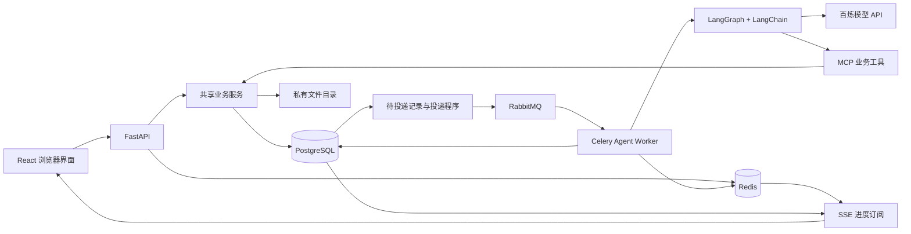

# Silencio Set — A Platform for Better Filming on Set

**寂静片场：面向学生剧组的协作与拍摄前期准备平台。**

将人员分工、设备资源、剧本资料和拍摄安排组织在同一个工作空间，再由 Diane 智能助手辅助查询与任务拟定，让剧组在开拍前明确责任、确认条件、发现冲突。

项目名称致敬大卫·林奇《穆赫兰道》中的 Club Silencio。“寂静”也寓意减少分工不清、信息分散和安排反复带来的沟通噪声，让片场更专注于拍摄和创作。

[GitHub](https://github.com/Lildoggy37/Silencio_Set-A_Platform_for_Better_Filming_on_Set) · [Gitee](https://gitee.com/lildoggy37/silencio_-set-a_-platform_for_-better_-filming_on_-set) · [项目介绍](docs/development/project-introduction.md) · [技术分析](docs/development/technical-analysis.md)

## 为什么做这个项目

通过小红书发帖和与学生剧组交流，项目发起人归纳出资源稀缺、人情化分工、分镜与通告准备不足、勘景遗漏和创作理解不一致等问题。这些是初步定性反馈，尚不代表正式用户研究或产品效果验证。

平台聚焦可以通过软件改善的部分：明确负责人、共享资源状态、统一筹备资料、检查拍摄安排。适用于课程短片、校园影视社团等学生团队；不能代替经费、专业设备、现场勘察和导演的创作决策。

## 已实现的功能

| 模块 | 主要能力 |
|---|---|
| 账号与剧组 | 邮箱验证码注册、密码登录、昵称补全、剧组创建与切换、成员邀请、兼任岗位及权限 |
| 任务与档期 | 负责人、协作人、截止时间、状态和成果记录；普通任务直接完成，重要任务可选验收；个人档期登记与授权查询 |
| 资源管理 | 设备、道具、场地登记；按时段和数量预约；可配置无冲突直接预约；借出、分次归还及耗材库存 |
| 创作筹备 | 剧本版本；TXT、DOCX、文字型 PDF 导入；人工场戏拆解、文字分镜、人物与演员绑定；私有勘景照片及场地条件 |
| 拍摄安排 | 计划草稿、人员与资源冲突检查、正式发布与撤回；每日通告、PDF 导出、站内通知及本人知悉回执 |
| 变更复核 | 关联资料变化提示、待处理清单、来源复核和显式检查历史 |
| Diane | 成员、任务、资源、档期及拍摄安排查询；私有会话、近期记忆、明确偏好；人工确认的任务提案；后台执行与进度展示 |

基础业务可以独立于模型使用。当前关注拍摄前期准备，不包含现场场记、后期素材归档、视频剪辑或专业音频处理。

## Diane 如何工作

Diane 通过已授权业务工具读取当前剧组资料，复用页面操作的权限及业务服务。成员人数查询读取成员名册；档期记录不能替代成员总数。涉及当前任务、资源和排期的事实，每轮重新查询，历史对话只帮助理解追问。

- **编排与工具**：LangChain 适配模型，LangGraph 编排有预算限制的单 Agent 循环，MCP 接入业务工具。
- **记忆与状态**：PostgreSQL 保存会话、用户明确偏好及运行检查点；近期上下文最多六轮成功问答，并限制字节数。
- **后台聊天**：请求持久化后返回受理状态，由 RabbitMQ／Celery 执行，SSE 展示阶段和最终结果。收起窗口后可重新读取同一次运行。
- **受控写入**：拟定最多五项任务，用户审阅后确认；后端重新校验权限，以一个事务创建任务，并以幂等标识避免重复创建。提案生成与确认目前同步执行。
- **调用记录**：展示运行耗时及模型返回的 token 用量；未知用量保留为未知，不作为零消耗。

当前模型为阿里云百炼 `deepseek-v4.1-flash` 兼容接口。模型身份和剧组范围由服务器固定，不提供任意 SQL、任意文件读取或权限变更工具。当前 MCP 在进程内执行 Streamable HTTP 协议通信，没有额外公开工具监听端口。

实现记录：[记忆与 MCP](docs/development/diane-memory-and-mcp.md)、[后台与 SSE](docs/development/diane-background-and-sse.md)、[任务提案](docs/development/diane-task-proposals.md)、[连续请求故障修复](docs/development/diane-client-lifecycle-fix.md)。

## 技术架构

采用**前后端分离的模块化单体**，API 与 Worker 分进程运行，业务服务和数据库共用。当前以本地运行及演示为主，不依赖云对象存储或微服务集群。

| 部分 | 技术 |
|---|---|
| 前端 | React、TypeScript、Vite、Ant Design、TanStack Query |
| 后端 | Python、FastAPI、Pydantic、SQLAlchemy、Alembic |
| 数据库 | PostgreSQL |
| 临时状态 | Redis：会话、验证码、限流、进度唤醒 |
| 消息与后台处理 | RabbitMQ、Celery |
| 智能助手 | LangChain、LangGraph、MCP、百炼模型兼容接口 |
| 文件 | 本地私有目录，通过后端鉴权访问 |



PostgreSQL 保存权威业务状态；Redis 不替代容量及权限校验。关键修改使用事务、并发版本和幂等回执；资源预约计算时间区间内的同时占用峰值，正式计划和通告保留版本与来源关系。

## 本地开发

准备 Python 3.12、Node.js 22.12 或更新版本，以及可连接的 PostgreSQL、Redis、RabbitMQ。项目保留 Compose 模板，也支持独立安装依赖服务。

在仓库根目录安装依赖；已有环境可以直接复用：

```powershell
py -3.12 -m venv backend/.venv
backend/.venv/Scripts/python.exe -m pip install -r backend/requirements-dev.lock
backend/.venv/Scripts/python.exe -m pip install --no-deps -e backend
npm.cmd --prefix frontend ci
```

参考 [.env.example](.env.example) 在根目录配置私有 `.env`。已有文件应手动合并，保留原密钥。配置实际的 `DATABASE_URL`、`REDIS_URL`、`CELERY_BROKER_URL`；启用账号功能需设置 `AUTH_ENABLED=true` 和私有随机 `AUTH_SECRET`。数据库迁移需可创建 `btree_gist` 扩展。

在 `backend` 目录执行迁移，再分别打开终端运行 API 和站内通知消费者：

```powershell
.venv/Scripts/python.exe scripts/dev.py migrate
.venv/Scripts/python.exe scripts/dev.py api
```

```powershell
.venv/Scripts/python.exe scripts/dev.py notifications
```

前端从仓库根目录启动：

```powershell
npm.cmd --prefix frontend run dev
```

访问 [本地前端](http://127.0.0.1:5173/)、[API 文档](http://127.0.0.1:8000/docs)及[依赖就绪检查](http://127.0.0.1:8000/api/v1/health/ready)。

首次邮箱注册需要另行配置 SMTP、`MAIL_ENABLED` 与 `MAIL_PAYLOAD_KEY`，并启动邮件 dispatcher／worker，详见 [SMTP 配置](docs/development/smtp-setup.md)。本地 SMTP 联调不等于真实邮箱已经配置。

启用 Diane 时，设置 `DIANE_ENABLED=true`、`LLM_API_KEY`、`LLM_BASE_URL` 和 `LLM_MODEL`。如使用后台聊天，先分别启动以下进程，并设置 `DIANE_BACKGROUND_ENABLED=true`；所有组件读取同一份配置：

```powershell
.venv/Scripts/python.exe scripts/dev.py agent-dispatcher
```

```powershell
.venv/Scripts/python.exe scripts/dev.py agent-worker
```

普通业务不需要启用 Diane。Windows Agent Worker 使用 solo，Linux 使用 prefork，当前启动入口默认单并发。完整步骤见[本地开发说明](docs/development/local-development.md)；现有演示环境的专用恢复入口见[本机演示说明](docs/development/tonight-demo.md)，其私有数据不包含在仓库中。

## 验证状态与限制

当前数据库迁移头为 `0028_diane_background`。核心筹备 HTTP 流程、数据库约束、浏览器交互、通知、PDF 和本地邮件已分批验证。Diane 已在同一个真实队列 Worker 中连续完成成员查询、一次身份切换提示和拍摄查询，使用虚构演示剧组与真实百炼模型；详情见[修复验证记录](docs/development/diane-client-lifecycle-fix.md)。

尚未完成真实剧组的完整产品试用、公开部署及高并发／长期稳定性验收。一次提示注入样例的正常回应不能代表全面安全评测通过。当前未实现扫描 PDF OCR、自动分镜生成、Agentic RAG／GraphRAG、自动最优排期、Agent 中断自动恢复、运行取消或逐 token 正文输出。

日常仅运行受影响模块的检查；前端生产构建命令为 `npm.cmd --prefix frontend run build`。历史验证范围见[数据库与缓存](docs/development/postgres-integration.md)、[浏览器](docs/development/browser-integration.md)和[消息与邮件](docs/development/mail-integration.md)。

## 目录与文档

```text
frontend/           Web 前端
backend/src/        API、业务服务与 Diane
backend/migrations/ 数据库迁移
backend/tests/      模块测试
backend/integration_tests/ 真实依赖联调
deploy/             本地部署模板
docs/requirements/  需求分析与核实记录
docs/design/        软件设计、权限及 UI 参考
docs/development/   实现记录、验证与演示说明
.env.example        配置名称示例
```

- [需求分析](docs/requirements/01_Silencio_Set需求分析.md)
- [课程提交版软件设计文档](docs/design/00_课程提交版软件设计文档.md)
- [项目介绍稿](docs/development/project-introduction.md)
- [技术分析](docs/development/technical-analysis.md)
- [UI 参考](docs/design/ui-reference-v1/README.md)与[Diane UI 参考](docs/design/diane-ui-reference-v2/README.md)

设计文档保留阶段性方案，当前能力以实现记录及验证范围为准。

## 配置与许可证

`.env`、密钥、数据库、会话、私有文件及运行日志均不提交；克隆仓库不会获得现有演示账号或数据。示例连接密码仅用于本地开发，不能用于公网部署。模型密钥只保存在后端，提问、近期对话及工具查询资料会按调用范围发送至模型提供方。

仓库公开，开源许可证尚待项目负责人确定，当前未添加 `LICENSE`。
