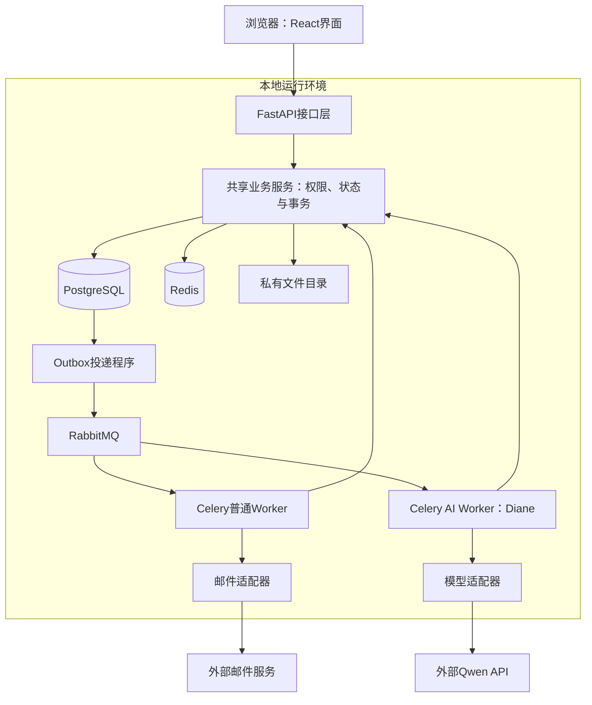
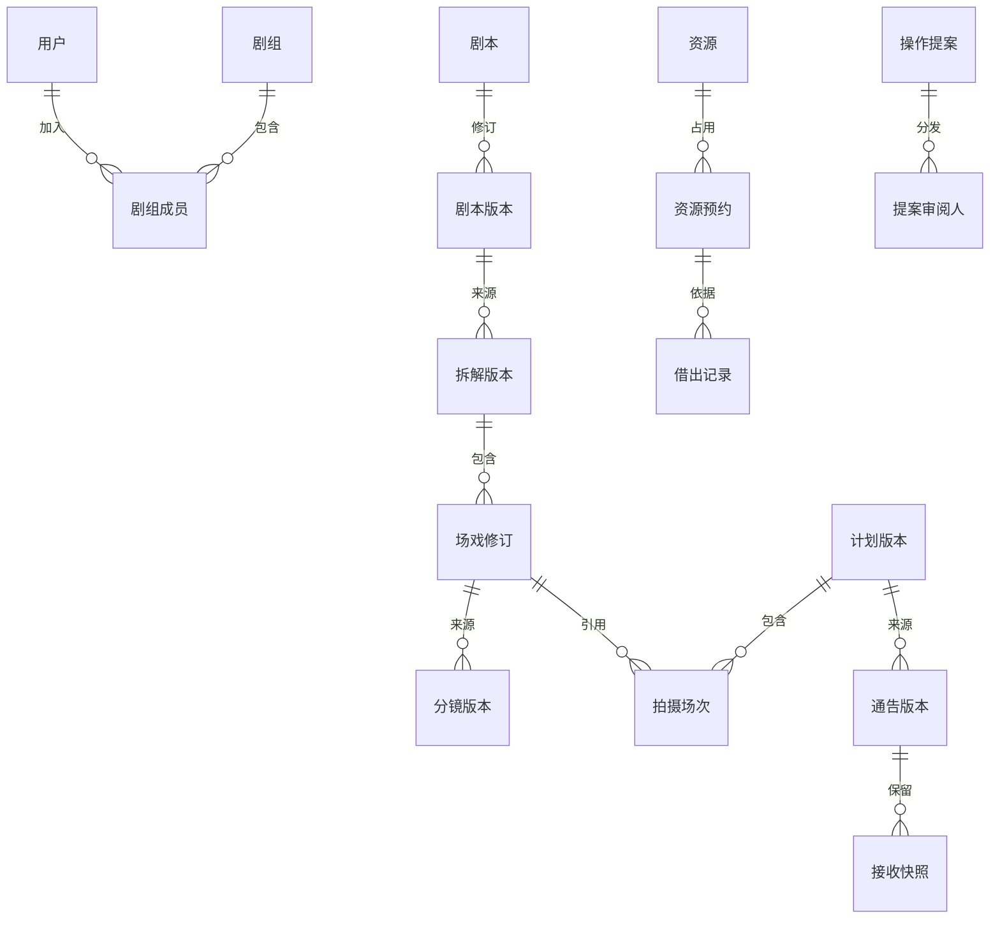

# Silencio Set · 寂静片场软件设计文档

版本：S1.0（课程提交精简版）  
设计对象：面向学生剧组的前期筹备管理平台。  
文档性质：架构与系统设计，不代表系统已实现或测试已通过。

## 1. 需求基线、范围与变更

### 1.1 目标与用户

学生剧组常面临资源稀缺、人情化分工、筹备不完整、临时改动和创作意见不一致。系统以明确责任、版本、资源和安排为基础，使成员在开拍前形成可执行、可追溯的准备结果。Silencio Set致意大卫·林奇作品中的Club Silencio，也寓意减少管理噪音，让片场专注创作。

主要用户为管理员、导演、制片／排期负责人、编剧、摄影、美术等工作人员及演员，允许兼任。采用浏览器访问的Web软件，不要求安装独立客户端；一组对应一个项目，用户可加入多个剧组。

### 1.2 编号需求与边界

沿用需求分析V0.8的FR-01—12、BR-01—08、NFR-01—11，不重新编号。功能为：FR-01组织权限，FR-02任务，FR-03剧本版本，FR-04场戏拆解，FR-05档期，FR-06资源预约借还，FR-07计划冲突检查，FR-08通知知悉，FR-09 Diane查询，FR-10操作提案确认，FR-11文字分镜，FR-12变更影响。

补充需求单独记录：SUP-01首次登录补昵称；SUP-02邮箱验证码注册、邮箱密码登录；SUP-03通告生成、审核发布及PDF导出；SUP-04场地勘景照片。补充来自负责人后续明确要求及逐批审阅，不假称原V0.8已全部包含。

与早期候选方案相比，当前改为本地单机、私有文件目录，不租云服务器、不用分布式存储；保留已确认的RabbitMQ。现场场记、素材归档、图像／多模态生成、自动最优排期、实时多人协同和GraphRAG不在首期范围。

基础阶段先实现普通管理及人工创作维护；增强阶段再接入Diane。优先级仍为FR-01—10高、FR-11—12中，优先级不等于必须同期开发。

## 2. 架构、部署与运行

采用模块化单体：前端、API及Worker分进程，本地运行，业务模块共用服务代码和PostgreSQL，不拆微服务。

| 层次／技术 | 职责与边界 |
|---|---|
| React、TypeScript、Vite、Ant Design、TanStack Query | 界面、表单和服务端状态；不持有模型密钥，不决定最终权限 |
| FastAPI、Pydantic | 认证、输入校验、HTTP响应；不复制核心业务规则 |
| 业务服务、SQLAlchemy／Alembic | 模块用例、权限、事务、数据访问和迁移 |
| PostgreSQL | 业务、版本、审批、任务、幂等结果、Outbox和审计的正式依据 |
| Redis | 会话、验证码、限流、必要缓存及短期加密邮件载荷 |
| RabbitMQ、Celery | 异步邮件、解析、导出、Agent执行；消息成功不等于业务完成 |
| LangGraph、LangChain、Qwen | 后期编排与恢复、模型适配和受控工具建议；不直接执行任意SQL |

后续使用Docker Compose组织本地依赖及持久目录。Qwen选择方向为负责人指定的Qwen 3.7系列，实际模型ID、地区地址、工具能力及依赖版本在初始化时验证锁定，不将名称写成已验证API配置。外部模型或邮件仍是依赖，本地运行不表示它们离线可用。

## 3. 模块与内部结构

| 模块 | 数据与内部职责 | 依赖 |
|---|---|---|
| 账号组织 | 邮箱验证、会话、昵称、邀请、成员、岗位及授权 | 邮件、Redis、数据库 |
| 任务 | 分配、开始、成果提交、指定人验收及历史 | 成员、场戏、通知 |
| 创作资料 | 文件解析、正文核对、版本、场戏拆解、文字分镜与审核 | 文件、Worker、权限 |
| 档期资源 | 本人时间区间、场地设备、范围授权、预约、变更、借还及耗材 | 成员、文件、事务锁 |
| 计划通告 | 排期预检发布、场次资源落实、每日通告、审核及导出 | 档期、资源、创作版本 |
| 通知影响 | 阅读／知悉、接收快照、变更问题、重新检查及复核 | 已提交业务事件、Outbox |
| Diane | 私有对话、顺序执行、工具目录、提案分发、决定恢复及用量 | 模型适配及上述业务服务 |

业务服务内部遵循“校验身份与范围→检查版本／状态→执行业务规则→事务保存结果、审计及待投递事项”。页面HTTP和Agent工具共用TaskService、ResourceService、PlanService、CallSheetService、ProposalService等入口；基础设施适配器不自行提交正式业务。模型、邮件及人工等待不持有数据库事务锁。

## 4. 数据设计与一致性

### 4.1 核心实体

| 实体组 | 关键字段与约束 |
|---|---|
| users／crew_members | UUID主键；邮箱规范化唯一；password_hash为Argon2id散列；display_name为1—30字，首次补全前可空；同剧组同用户唯一，离组留历史 |
| roles／permissions／授权 | 固定代码与关联记录，兼任取并集，明确拒绝优先；资源范围另表，不能凭角色名称绕过对象责任 |
| tasks／submissions | 标题1—100字；一名负责人、一名确认人；截止时间TIMESTAMPTZ；状态和lock_version；提交序号在任务内唯一 |
| files／scripts／paragraphs | 文件元数据与私有存储标识；剧本版本号对象内唯一；完整正文由有序段落组成；确认后不覆盖 |
| scene_breakdowns／scene_revisions | 拆解绑定剧本版本；同拆解场戏编号及稳定场戏标识分别唯一；来源段落范围有效 |
| storyboard_versions／shots | 来源修订固定；镜号、排序在版本内唯一；画面1—2000字；预计时长为可空正整数秒 |
| availability／resources | 本人区间禁止重叠，集合版本防覆盖；资源可复用数量与耗材库存互斥，范围授权必须同组 |
| reservations／checkouts／returns | 区间、正整数数量、审批状态与版本；只有确认预约占容量；累计归还不超借出，流水与库存同事务 |
| plans／sessions／preflight | 当前发布指针、版本、固定场戏修订、成员、场地、预约分配；预检绑定当前数据集合和未知项 |
| call_sheets／versions／recipients | 同计划同日期唯一；草稿接收集合与审核绑定，发布快照不覆盖；来源计划版本固定 |
| agent_runs／proposals／reviewers | 私有对话、run、请求键、提案版本、决定及业务结果；分发不授权，多候选仅一次有效决定 |
| jobs／Outbox／audit／impact_issues | 执行token、租约及心跳；事件键去重；审计独立保留；问题状态与通知已读分离 |

### 4.2 一致性规则

- 剧组数据均带crew_id，引用同时检查同组；时间存TIMESTAMPTZ，按Asia/Shanghai显示，区间左闭右开。
- lock_version是并发版本，不是剧本／计划业务版本号。修改比较旧值，冲突拒绝，不静默覆盖；已确认资料修改创建新版。
- 排期相关写入先锁剧组，再按固定顺序锁资源及记录；事务内计算同时占用峰值，不简单累加所有有交集预约。预约与计划分配不重复计占用。
- 幂等键绑定主体、动作、对象和内容，同键同内容返回既有结果，同键异内容拒绝；返回前仍校验当前访问权。
- PostgreSQL事务不跨Redis、文件和消息队列。业务结果、成功审计及Outbox共同提交，提交后投递；消费者允许重复消息但禁止重复业务变更。
- Worker条件取得execution_token和租约，续租及写回须匹配当前有效执行权；旧Worker不能覆盖接手结果，租约仍不能代替业务幂等。

## 5. 关键流程设计

| 场景 | 正常路径 | 分支与异常 |
|---|---|---|
| 注册入组 | 邮箱验证码→一次兑换注册凭证→设置密码→登录→补昵称→创建剧组或接受邀请 | 重发旧码失效；邀请7天有效、可撤销；未补昵称后端拒绝业务；同凭证重试不覆盖密码 |
| 任务 | 待处理→进行中→提交→待确认→指定确认人验收→完成 | 退回恢复进行中，重提留新记录；取消与验收并发只产生合法最终状态 |
| 剧本创作 | 上传／粘贴→异步解析→人工核对→确认→选择工作版本→拆解／分镜送审 | 创作草稿→待审→确认；退回为rejected，显式reopen恢复草稿；确认后只能另建版本 |
| 资源 | 待审申请→负责人重检批准→预约有效→授权经办借出→分次归还 | 待变更期间旧预约有效；批准新条件时排除自身；提前取用先改预约；停用或过期仍可归还 |
| 计划 | 编辑草稿→预检→处理阻断／确认未知→事务重检→发布切换→通知 | 已知冲突不能豁免；前场12:00结束加30分钟，12:29不能通过、12:30可通过该项；数据变化须重检 |
| 通告 | 从有效已发布计划按日生成→补集合信息及接收人→共同审核→发布→通知及PDF→知悉 | 场次按开始日归属；参与者必选；改正文或集合须重审；新增接收人走新版本；旧版回执不迁移 |
| 影响复核 | 变更标记待检查→按已录入关联生成问题→修复／授权复核→重检解除 | 已读不解除；待检查不显示全部就绪；旧检查不覆盖新变化；来源再换稿旧复核失效 |

Diane采用“请求→授权查询→草稿或操作提案→授权人员确认／拒绝→恢复调度→再次校验→执行与记录”。同一对话顺序推进，等待人时释放Worker。提案confirmed仅表示已确认待调度，executing才表示实际执行；接受返回202不代表业务完成。私有对话不向他人开放，审阅人只看最小提案，确认不豁免权限、版本和冲突。

## 6. 接口设计

### 6.1 统一约定

路径前缀/api/v1，JSON使用snake_case，上传multipart/form-data，标识UUID。列表page/page_size默认20、最多100，排序白名单。Cookie会话，修改请求X-CSRF-Token；关键审批、发布、借还和提案决定携带Idempotency-Key。expected_lock_version为必填正整数，首次发布的expected_current_published_version_id明确传null。

成功响应为`{data:结果,request_id:追踪标识}`；错误为`{error:{code,message,details},request_id}`。采用200／201／202／204；401身份、403权限、404不存在或隐藏、409业务冲突、413大小、415类型、422输入、429限流、503依赖故障。文件流及204不套JSON，不暴露路径、SQL、堆栈或密钥。

### 6.2 核心接口契约

下表C表示/api/v1/crews/{crew_id}；除查询外均验证CSRF。字段“是”为必填，字符串上限与数据设计一致。

| 接口 | 主要输入 | 输出与限制 |
|---|---|---|
| POST /auth/email-verifications及/verify | email；验证时另含请求ID、code | 202受理；200短期registration_token，非登录会话 |
| POST /auth/register、/login | 注册token＋password；登录email＋password | 注册201不自动登录；登录200设置服务端会话 |
| PATCH /users/me/profile | display_name字符串1—30、expected_lock_version，均是 | 200完成状态及新版本；未补信息只能访问资料、认证辅助及退出 |
| POST C/tasks；/tasks/{id}/submissions、/reviews | 标题、负责人、确认人、截止时间；提交说明；验收decision、submission_id、版本 | 创建201，提交／验收返回实际记录；工作限负责人，验收限确认人 |
| POST C/scripts/{id}/versions | 输入类型、文件ID或粘贴正文二选一 | 202版本和job_id；确认及切换工作版本分别操作 |
| POST C/scene-breakdowns/{id}/reviews、/reopen | decision、退回说明及版本；reopen仅版本 | 审核／重新编辑200；待审不能编辑、已确认不能reopen |
| PUT C/members/me/availability | 替换范围、区间集合、集合版本，均是 | 200新区间与版本；仅本人，范围外部分保留 |
| POST C/resource-reservations/{id}/decisions | decision=accept/reject、版本；拒绝说明必填≤500字 | 200confirmed/rejected及新版本；需审批权限、资源范围和负责人 |
| POST C/plan-versions/{id}/preflight、/publish | 预检版本；发布另含原当前指针、检查标记、confirmed_unknown_item_ids数组 | 预检200阻断及未知项；发布200版本、受影响通告、通知待投递；禁止force绕过 |
| PUT C/call-sheet-versions/{id}/recipients | member_ids不重复UUID数组、版本，均是 | 200必选／额外已选集合及新版本；不可遗漏参与者 |
| POST C/call-sheet-versions/{id}/reviews、/publish、/exports | 审核决定／备注／版本；发布原当前指针；导出PDF | 审核与发布200；导出202 job_id；内容接收集合共同审核 |
| POST C/notifications/{id}/acknowledge | 通知关联版本，是 | 本人明确知悉；已读不是知悉，知悉不是审批 |
| POST C/conversations/{id}/runs；/proposals/{id}/decisions | 用户消息及授权引用；决定、提案版本、可选说明≤500字 | 请求202；拒绝200；接受202含run及恢复任务，未完成不显示成功 |
| GET C/proposals、/impact-issues；POST C/impact-issues/{id}/source-reviews | 列表scope／筛选分页；复核含问题版本、当前工作稿、结论及1—1000字依据 | 列表200按权限过滤；复核201，仅来源问题可人工核对，不改旧来源或已发布安排 |
| GET /jobs/{id} | 路径UUID，是 | 授权任务状态、阶段及结果；不暴露Celery内部负载 |

关键409错误包括VERSION_CONFLICT、INVALID_STATE、RESOURCE_CAPACITY_CONFLICT、PREFLIGHT_STALE、CURRENT_VERSION_CHANGED、REVIEW_REQUIRED、SOURCE_PLAN_STALE、PROPOSAL_INVALIDATED及IDEMPOTENCY_KEY_REUSED。客户端保留输入、刷新核对或按原键恢复，不换键盲目重做。

### 6.3 内外部接口

内部服务输入可信身份上下文及业务参数，输出结构化结果或业务错误；HTTP层映射状态，Worker恢复重新验证。ModelAdapter输入授权messages、allowed_tools、后端配置、输出上限和截止时间，返回content、工具建议、结束原因、实际模型、调用标识及usage；截断、非法参数与未知用量不假装完整成功。

MailAdapter输入受控模板、单收件人、短期敏感载荷引用、消息标识及有效期，返回accepted／rejected／unknown，accepted不代表送达。Redis保存短期认证加密载荷，消息及Outbox仅持引用；密钥独立保管，过期、丢失或解密失败停止发送，不从摘要反推验证码。模型及邮件认证、限流、超时和服务错误分别分类，有限重试只由明确一层负责，不叠加SDK、业务与Celery。

## 7. 界面、角色与交互

沿用已确认UI：国际主义网格、红黑暖白、方角和必要留白；一级导航总览、排期、资源、成员，资料从顶部入口进入，通告在排期内发送，任务从总览“全部任务”进入。

| 页面 | 关键交互 |
|---|---|
| 登录／个人信息 | 首次补昵称；邀请登录后续接但不自动加入；失效会话不自动重放写操作 |
| 总览／任务 | 仅相关待办及两项数量；无排期不显示假日期，无有效通告不编造集合；负责人提交、确认人验收 |
| 排期 | 草稿与发布分开，冲突定位，未知项默认不勾；预检变化重做，发布显示实际版本及投递状态 |
| 通告发送 | 来源、预览、必选／可选接收人、送审发布；PDF失败保留网页；旧通告提示复核／撤回 |
| 资源／成员 | 资源按范围授权，照片局部失败；管理员只组织管理，不自动业务发布；档期只能本人维护 |
| 资料／Diane | 正文核对和固定来源，创作退回显式重新编辑；Diane未启用不显示可用，提案独立最小详情 |

权限在后端实时判断：导演默认审核创作，编剧编辑，制片管理任务排期资源及通告；普通成员仅本人或相关范围。管理员可授予预定义岗位／业务权，不等于可执行；明确拒绝优先。预约批准还需资源负责人；提案分发不授权，任一合格候选一次决定即可。

未保存离页或切组提醒；版本冲突保留输入不强盖；加载失败不显示假0；错误有文字及下一步，不只按钮置灰或依赖颜色。桌面优先复杂编排，390像素手机须能查看本人安排、确认通知、更新本人任务及维护档期，关键操作不裁切、键盘可达。

## 8. 非功能与安全设计

| 方面 | 设计及可验证目标 |
|---|---|
| 性能与扩展 | 分页、索引、连接池及队列隔离；普通业务与AI分别测量，不宣称单机高可用或未测QPS |
| 缓存 | 必要查询按剧组和权限范围缓存；TTL抖动、热点互斥、必要空值缓存及受控回源；审批发布检查数据库 |
| 队列 | notifications、documents、agent分队列，按进程资源隔离；Outbox投递确认与持久结果后消费确认，重试有界 |
| 认证 | Argon2id、会话轮换、HttpOnly，HTTPS Secure、适当SameSite及独立CSRF；验证码单次使用和登录限流 |
| 注入与隔离 | 参数化SQL、排序白名单、文本转义／受限富文本、上传实检、私有路径；资料提示注入不能扩大工具与权限 |
| 输入边界 | 剧本DOCX／文本PDF／TXT／粘贴，文件20MiB、正文10万字符，无OCR；勘景静态JPEG／PNG／WebP，10MiB、2500万像素、每场地20张、说明500字，规范方向并清除EXIF定位 |
| 通告模板 | gathering_at与地点送审／发布必填，不晚于第一场；地点300、联络说明500、备注2000字；网页PDF共用确定快照 |
| 隐私与维护 | 只收必要昵称与档期，离组失权，模型与导出最小披露；.env及密钥不入库；迁移及配置版本化 |
| 可观测 | 追踪请求／任务／run，记录错误、慢查询、队列最老等待、租约、磁盘、备份及Agent用量；日志脱敏，不用私人原文作标签 |

一次Agent请求记录总历时、排队、模型与工具调用、人工等待、全部重试token；未知用量不填0，估算分开。工作时限、轮数和token预算由后端控制，达到限制停止并保留已完成事实；人工等待单列，不占Worker。性能阈值、并发、认证时效和分类预算在固定环境测试后冻结，不把待测值写成达标结果。

## 9. 异常、降级与恢复

| 故障 | 处理与边界 |
|---|---|
| 模型失败 | 普通任务、资源及排期仍不依赖模型；人工维护草稿，不默认跨供应商切换 |
| 解析／图片／PDF失败 | 提供替代输入或局部错误；PDF保留网页，不拿旧版本冒充；原工作稿不变 |
| 邮件或队列失败 | 已持久受理显示等待，有限重试；结果unknown不宣称未发送，旧验证码仍按有效性拒绝 |
| 普通缓存失败 | 仅会话仍可验证且数据库容量允许时限流回源；整个认证Redis故障不得免认证 |
| 数据库不可用 | 停止正式修改，不按旧缓存批准或发布；恢复后重新校验 |
| 保存响应丢失 | 查询或原幂等键恢复，避免重复扣库存、发布及创建 |
| 业务成功后模型回答失败 | 按持久业务结果确定性反馈，不为补回答重做操作 |
| 成功审计写入失败 | 回滚该次正式变更；失败审计另行记录，不假称审计完整 |

每日备份数据库与私有文件，目标恢复点不超过24小时、目标恢复时间不超过4小时，均待演练验证。首期维护窗口暂停写入、消费及清理，生成配套备份、版本清单和摘要，加密且至少一份独立物理介质副本；真实密钥独立保管。

恢复先停止API写入及Worker，核对数据库文件引用、迁移与任务结果，使旧会话失效，再受控补投。旧备份可能丢失已发生的邮件／模型记录，不能仅因本地无记录盲重放；旧提案不自动批准。至少一次隔离恢复演练记录实际恢复点及耗时。

## 10. 设计决策与权衡

| 决策 | 理由 | 接受的代价／重新评估条件 |
|---|---|---|
| 单体＋独立Worker | 个人可维护，规则及事务统一 | 单机故障范围大；出现真实独立扩容需求再拆分 |
| PostgreSQL＋Redis＋RabbitMQ | 正式状态、临时认证及异步职责明确，保留既定MQ | 组件运维成本；不为技术数量增加更多基础设施 |
| 剧组协调锁＋幂等＋Outbox | 便于证明并发正确与可靠恢复 | 同组写入串行；实测瓶颈再细化锁，不牺牲校验 |
| 本地私有文件 | 无需当前不必要云存储 | 单盘风险与配套备份；多机需求出现再评估 |
| 固定版本、整份编辑 | 来源稳定、历史可追溯 | 无实时协作，冲突需核对；真实冲突频繁再评估协同 |
| 普通业务先行、Agent提案确认 | 模型故障不影响基础能力，重要操作可控 | 增加确认与状态管理，不赋予Agent特权 |
| 暂不GraphRAG／多Agent | 当前核心是结构化业务与约束，不为技术堆栈造需求 | 有跨文档问题及评测收益后另行确认 |

改变决策须记录原选择、原因、影响需求、替代代价和验证方式，更新关联设计与测试，不静默改需求。

## 11. 需求—设计—测试追溯

以下TG为测试组入口，不代表已执行；具体验收沿用原AC及SUP定义。

| 需求 | 本文设计位置 | 测试组与重点 |
|---|---|---|
| FR-01 | §3、4、6、7 | TG-F01：邀请、兼任、越权、末位管理员及交接 |
| FR-02 | §4—7 | TG-F02：唯一负责人、验收退回及取消竞争 |
| FR-03 | §4—6、8 | TG-F03：格式边界、正文确认、历史与工作版本 |
| FR-04 | §4—7 | TG-F04：人工维护、原文、整份审核及reopen |
| FR-05 | §4—7 | TG-F05：本人区间、未知、集合版本及并发 |
| FR-06 | §4—6、9 | TG-F06：并发批准不超量、变更、借还与幂等 |
| FR-07 | §4—6 | TG-F07：冲突、转场、预检失效、发布指针竞争 |
| FR-08 | §4—7 | TG-F08：阅读／知悉分离、新版重确认、去重 |
| FR-09 | §3、5—8 | TG-F09：答案有依据、未知不当就绪、隔离 |
| FR-10 | §4—6、9 | TG-F10：拒绝、撤权、失效、并发决定及恢复 |
| FR-11 | §4—7 | TG-F11：无模型可编辑、草稿审核、来源一致 |
| FR-12 | §4、5、6.2、9 | TG-F12：提醒去重、复发、复核与旧结果拒绝 |
| SUP-01—04 | §1、5—8 | TG-S01—04：昵称、邮箱、通告及勘景输入权限 |
| BR-01—04 | §4、5、7 | TG-B01—04：隔离、职责、分权及AI草稿 |
| BR-05—08 | §4—6、9 | TG-B05—08：区间转场、未知、版本审计及重检 |
| NFR-01、02、11 | §8、12 | TG-N01、02、11：分类性能、时效、用量与预算 |
| NFR-03—05、09、10 | §4、8、9 | TG-N03—05、09、10：安全、可靠、降级、隐私及审计 |
| NFR-06—08 | §7、12 | TG-N06—08：真实试用、兼容与AI质量 |

## 12. 测试验证与当前限制

采用单元、真实依赖集成、后台任务、端到端和专项测试。集成使用隔离PostgreSQL／Redis／RabbitMQ及文件目录，不以纯内存替身证明事务；并发使用同步屏障和独立事务，不把快速顺序请求当竞争。模型模拟与真实API、受理耗时与完成耗时分别报告。

| 验证类别 | 重点及判定 |
|---|---|
| 业务端到端 | 注册补资料入组；任务提交验收；资料→资源档期→计划→通告→知悉；Agent提案决定到实际结果 |
| 安全与并发 | 跨组与注入、两管理员并发退出、两预约竞争、重复归还、计划发布竞争、旧Worker迟到；未经授权及重复变更为0 |
| 故障与恢复 | 依赖断连、消息重复、提交后响应丢失、模型答复失败、配套备份恢复，核对真实持久结果 |
| 性能 | 固定机器、版本、数据、请求组合及冷热缓存，逐步加负载，报告吞吐、P50/P95、错误、CPU／内存与排队；探索后冻结阈值并独立正式验收 |
| 易用与兼容 | 简短说明后5名试用者至少4人在5分钟内查看本人安排并确认通知；固定Chrome／Edge版本及390像素验证关键任务 |
| AI质量及计量 | 至少10段合计30场戏人工标注，场戏F1暂定≥0.85，人物道具精确率／召回率分报；分镜审阅一致性及可编辑性；至少20次请求检查计量完整性，不当作容量证明 |

每条用例记录需求、前提、角色、输入步骤、HTTP和数据库／文件断言、证据及未执行／通过／失败／阻塞状态，不能只看200。证据脱敏，不提交真实密钥、私人剧本或真实邮箱；失败修复后回归，不删除失败事实。

当前已形成设计与关键用例，尚未实现或执行测试。实际模型ID、依赖版本、运行与认证参数、性能阈值及分类预算待固定；部分关联索引、完整接口结构、页面组件和监测配置在实施时细化。提交本设计不代表上线、容量、安全或恢复目标已验证。若实现中调整需求，应同步本文件、详细设计、追溯矩阵及测试。
