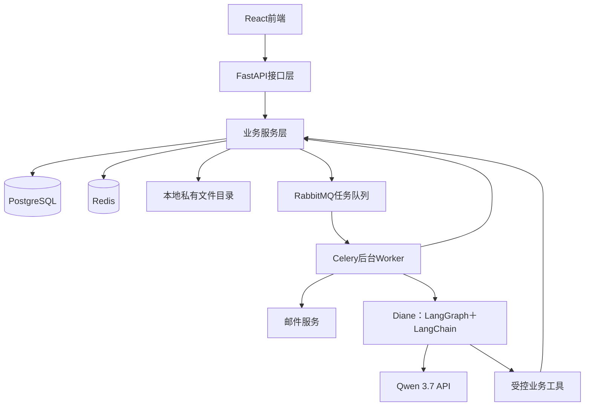

# Silencio Set · 架构与模块设计

版本：D0.2  
状态：架构及模块基线已同步后续数据、接口、权限和非功能设计；未实现或验证运行。  
需求依据：需求分析V0.8及SUP-01—04补充、场记排除和本地部署等已确认约束。

## 1. 设计范围与原则

系统面向学生剧组的拍摄前期准备，以本地运行的模块化单体实现。前端、API和后台Worker分别运行，业务模块属于同一个后端项目，共享业务服务和数据库。Redis与RabbitMQ分别承担缓存及消息调度职责，文件保存在本地私有目录。

基础业务先独立完成，再接入Diane；不配置模型时，成员仍可通过页面完成剧组、任务、资源、排期和通告单等管理。当前不引入云服务器、云对象存储、分布式部署或现场场记模块。

## 2. 系统结构

图中的业务服务是API及Worker共享的代码能力，不是另一个网络服务；Worker调用业务服务不意味着每次都通过HTTP请求API。Diane的受控工具同样调用业务服务，不直连数据库执行任意查询或修改。

| 组件 | 职责 | 数据边界 |
|---|---|---|
| React前端 | 页面、表单、任务状态及人工确认交互 | 不持有模型密钥，不作为权限判定依据 |
| FastAPI接口层 | 身份认证、输入校验、调用业务服务及返回结果 | 从可信登录上下文识别用户及剧组范围 |
| 业务服务层 | 权限、状态转换、冲突、审批和事务 | 正式业务变更的统一入口 |
| PostgreSQL | 业务、版本、审批、任务状态及审计记录 | 正式状态的依据，数据库约束与事务参与正确性保证 |
| Redis | 验证码、会话、限流及必要缓存 | 临时状态；缓存不能替代最终业务校验 |
| RabbitMQ | 将任务消息交给后台Worker | 消息不是任务完成或业务提交成功的证明 |
| Celery Worker | 邮件、文件解析、导出和后期AI任务 | 按任务标识执行、记录结果并处理有限重试 |
| 本地私有目录 | 剧本、勘景照片及通告单文件 | 通过后端鉴权访问，不直接公开整个目录 |
| Qwen API | 理解、生成与工具调用建议 | 仅接收必要的授权数据，具体模型ID配置化 |

## 3. 后端分层

| 层次 | 内容 | 约束 |
|---|---|---|
| 接口层 | HTTP输入输出、身份识别、字段校验 | 不自行复制预约审批等业务规则 |
| 业务服务层 | 模块用例、权限、规则、事务协调 | 页面与Agent复用同一入口 |
| 数据访问层 | 查询、保存、数据库约束和锁定操作 | 不独立决定用户是否获准发布计划 |
| 基础设施层 | 文件、邮件、队列、缓存、模型适配 | 通过明确入口调用，外部失败转换为可处理结果 |

层次是代码职责划分，不要求拆成不同部署服务；具体目录结构在代码初始化时落实。

## 4. 模块及数据归属

“归属”指维护规则与写入责任，不代表每个模块使用独立数据库。跨模块使用数据通过相应业务服务完成，避免多个模块各自改写同一状态。

| 模块 | 负责维护的业务数据 | 主要依赖 | 需求对应 |
|---|---|---|---|
| 账号与认证 | 账号、邮箱验证、登录、首次资料补全及会话 | 邮件、Redis | SUP-01、02、FR-01、NFR-03 |
| 剧组与权限 | 剧组、成员、岗位及授权 | 账号身份 | FR-01、BR-01—03 |
| 任务管理 | 任务、责任人、进度、提交与验收 | 剧组权限、场戏引用、通知 | FR-02 |
| 剧本与场戏 | 文件正文、剧本版本、场戏和原文引用 | 剧组权限、文件、后台解析 | FR-03、04 |
| 分镜与创作资料 | 文字分镜版本及审核状态 | 剧本版本、场戏、剧组权限 | FR-11 |
| 人员档期 | 成员本人可用及不可用区间 | 成员身份、剧组权限 | FR-05 |
| 场地与资源 | 资源范围、预约、借还及勘景照片关联 | 成员、文件、通知 | FR-06、SUP-04 |
| 拍摄计划 | 场次、安排、转场时间、发布版本和发布确认 | 场戏、档期、资源、剧组权限、通知 | FR-07 |
| 通告单 | 草稿、模板字段、接收审核快照、发布版本及导出结果 | 拍摄计划、成员、文件、后台导出、通知 | SUP-03／AC-SUP-03，与FR-07、08联动 |
| 通知中心 | 通知、接收人、阅读及知悉确认状态 | 已完成业务事件、成员 | FR-08 |
| Diane | 对话、执行上下文、工具调用、操作提案与用量记录 | 模型、上述业务服务、审批及审计 | FR-09、10及FR-04、11增强部分，NFR-11 |

文件、异步任务、审计和变更影响检查作为公共能力支撑上述模块。FR-12通过D03第29节记录检查状态和问题，辅助复核而不独立维护另一套计划或资源事实；问题未生成不保证就绪，正式发布实时检查。

## 5. 模块协作约束

### 5.1 计划、通告单与通知

拍摄计划是正式安排依据。通告单引用确定的计划版本，补充集合时间、地址、联络信息和注意事项，经过审核后发布。计划更新时，旧通告单标记需要更新，由负责人修订或重新生成并发布，不静默覆盖已确认版本。

通告单不得直接反向改写拍摄计划；需要调整安排时进入计划模块。通知中心分发发布及变更事件，记录成员是否知悉。通知已读或已确认不等于成员有权批准排期，也不代表资源预约生效。

### 5.2 权限与资源正确性

系统在业务服务中检查剧组范围及操作权限。缓存适用于重复读取的概览、统计和已发布资料，但预约批准、计划发布及权限修改必须检查正式状态，并在事务中处理竞争修改。

普通缓存失效时仅在身份仍可验证且容量允许时限流回源；整个认证Redis不可用不绕过会话或验证码。缓存防护、重建及过期策略见D06第5节，具体运行值仍待测。岗位、资源范围和对象责任见D10。

### 5.3 文件与勘景

文件模块保存文件及访问元数据，具体业务模块维护资料关联。勘景照片关联场地，导演经权限检查查看，静态图片输入及元数据清理见D03第12.2节、D05第26.3节；不增加独立勘景审批系统，不默认发送模型。

### 5.4 后台任务与审计

业务数据库记录任务及待投递事项，消息只携带任务标识和必要引用。后台投递、执行与重试需要防止重复业务变更；失败不能显示为成功，正式结果仍以数据库记录为准。

普通任务与AI任务分别排队、分别配置Worker，避免长模型调用阻塞邮件和导出。审批、权限修改等业务动作不因放入队列而取消执行时校验。重试次数、超时和投递补偿方式在详细设计中确定。

通知服务于成员知悉，审计服务于事后追溯。操作成功或失败均记录相应结果，删除通知不删除审计记录。

## 6. Diane设计边界

| 内部职责 | 内容 |
|---|---|
| 请求与上下文 | 绑定用户、剧组、对话及场戏等授权引用 |
| 模型适配 | Qwen消息、工具调用、返回及用量处理 |
| 工具目录 | 授权查询、筹备检查、草稿及操作提案 |
| 流程与恢复 | 执行步骤、确认等待、恢复和失败 |
| 调用记录 | 耗时、token、工具执行、重试和结果 |

查询类请求在授权范围内执行；修改类请求按“理解请求—查询数据—生成提案—等待确认—重检权限、版本与冲突—执行—记录及通知”运行。

LangGraph检查点保存运行上下文，业务数据库保存审批和正式执行结果。恢复对话不意味着可以再次执行业务动作，必须检查是否已执行及是否仍获授权。初期采用一个Diane配合多个业务工具，不预先拆成多个独立角色Agent。

## 7. 本地运行结构

前端、FastAPI、普通Worker、后期AI Worker以及PostgreSQL、Redis、RabbitMQ在本地运行，后续使用Docker Compose组织。Nginx可作为统一访问入口。模型与正式邮件可调用外部服务；开发邮件测试和具体端口在运行配置中另行确定。

数据服务需持久化，本地上传目录与配置不提交Git。单机结构不承诺高可用或具体QPS；并发、错误率和模型吞吐按需求7.4另行确定并验证。

## 8. 后续设计衔接

本章确认组件与模块边界。D02—05已补概念、字段、流程及核心接口，D06—11补非功能、权衡、追溯、测试、权限及页面交互。SUP-01—04已在需求README定义并进入D08矩阵，不再作为未编号范围。UI沿用总览／排期／资源／成员及项目资料入口，不重新设计导航。

注册使用邮箱验证码、日常邮箱密码登录、首次登录补昵称；具体模型ID、依赖版本、运行参数及性能数值仍需验证。其余关联索引与接口、实际实现和测试继续依据D08缺口推进，不将设计成文视作已实现。
