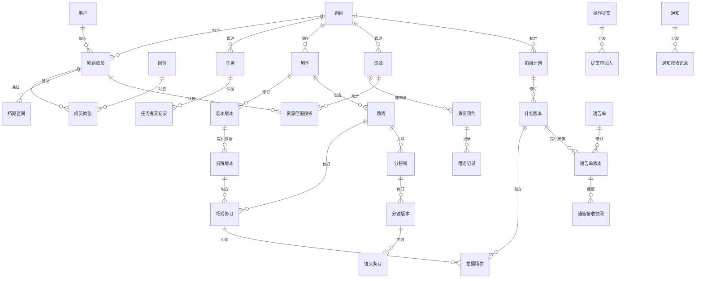

# Silencio Set · 数据模型与实体关系

版本：D0.2  
状态：概念模型已同步后续字段及流程设计；部分关联索引、实现及验证待完成。

## 1. 设计依据与范围

本章承接《01_架构与模块设计》，以需求分析V0.8及后续确认范围为依据。使用一个PostgreSQL数据库，按业务模块组织数据；剧组业务记录具有明确的剧组归属，账号为跨剧组身份。

本章的“实体”描述业务对象，不意味着每个实体都需要独立页面或服务，也不要求每个概念立即对应一张数据库表。验证码等临时数据由Redis管理；文件正文、图片及导出文件保存在本地私有目录，数据库记录元数据和业务关联。

## 2. 核心实体及归属

| 模块 | 实体 | 用途与关联需求 |
|---|---|---|
| 账号 | 用户、邮箱验证码、注册凭证消费、短期加密发送载荷 | 账号身份、首次补昵称及注册验证；SUP-01、02。验证码及载荷有有效期，不作为长期业务结果 |
| 剧组组织 | 剧组、成员关系、邀请、岗位、权限及授权关系 | 用户加入剧组、兼任岗位，权限与身份分开；FR-01 |
| 任务 | 任务、任务提交记录 | 保存负责人、确认人、进度、提交及验收历史；FR-02 |
| 剧本 | 剧本、版本、正文段落、拆解版本、场戏、修订及审核历史 | 保留稳定标识、整份拆解及原文依据；FR-03、04 |
| 分镜 | 分镜稿、分镜版本、镜头条目 | 保存场戏的文字分镜及审核结果；FR-11 |
| 人员档期 | 档期区间及集合版本 | 本人维护、整段替换防覆盖，未登记显示未知；FR-05 |
| 场地资源 | 资源、范围授权、需求、预约、预约变更、借还及库存流水 | 区分需求、落实、占用及实物，范围不代替权限；FR-04、06 |
| 勘景资料 | 场地照片关联及规范化图片文件 | 同组私有文件关联场地，不默认AI分析；SUP-04 |
| 拍摄安排 | 拍摄计划、计划版本、拍摄场次、参与人员及资源使用关联 | 保存各版场次及对应人员、场地和资源；FR-07 |
| 通告单 | 通告版本、审核、草稿接收集合及发布快照 | 来源确定，模板和接收集合共同审核，版本化PDF；SUP-03 |
| 通知 | 通知、通知接收记录 | 区分业务事件及每位接收人的阅读、知悉确认；FR-08 |
| 公共能力 | 文件、任务及租约、Outbox、预检及发布确认、影响问题及检查状态、审计 | 可靠处理、待检查与事实区分、确认追溯；FR-12、BR-07、NFR-04、10 |
| Diane | 私有对话、执行、提案及审阅分发、模型／工具调用记录 | 授权上下文、待调度与执行区分、恢复幂等及用量；FR-09、10、NFR-11 |

## 3. 主要实体关系

图中只展示主要关系，不代表完整物理结构。岗位与权限、场次参与人员及资源使用等多对多关系通过关联记录表达，具体约束在表结构设计中明确。

## 4. 关键建模决定

### 4.1 用户、成员与权限

用户表示系统账号；剧组成员表示该用户在特定剧组中的身份。任务负责人、确认人及预约申请人引用剧组成员，不能只引用用户而忽略其剧组身份。

同一成员可以关联多个岗位。导演、制片等岗位提供业务语义，实际操作根据授权判断；本阶段不扩展为复杂的自定义岗位系统或审批流程编辑器。退出或移除保留成员历史关系，停止其访问和操作权限。

### 4.2 对象与版本

剧本、场戏、分镜、计划和通告单具有稳定对象标识，版本或修订保存具体内容。拆解版本绑定一个已确认剧本版本并含一组明确场戏修订；分镜版本引用确定场戏修订，来源剧本版本由该修订确定，不另存可矛盾来源。拍摄场次引用确定修订，通告引用确定计划版本，已确认内容修改另建版本。

已经发布或确认用于正式安排的内容不能随当前工作版本静默改变。成员显示名称、场地或资源名称等会影响历史展示的信息，在发布版本中保留必要快照；稳定标识用于关联，快照用于还原当时内容。

剧本更新后建立新修订或标记待复核，具体流程承接FR-03、04、12。关联变化不能通过改写旧发布版本实现。

### 4.3 资源需求、预约与耗用

场戏资源需求表达“需要什么、多少”，允许尚未关联具体设备；预约表达某时段申请或已批准的实际占用。未落实的需求不因为已创建记录就视为准备完成。

设备、道具、场地属于可复用资源，按时段及数量检查占用；耗材按库存及变化记录管理，不生成时间预约。设备和道具的借还记录可以分次归还，并保留与预约的关系。

### 4.4 通知与确认

通知表示一次业务事件，接收记录保存具体成员的阅读及确认状态。确认关联具体业务版本，旧版确认不自动适用于新版本。阅读、确认知悉和业务审批具有不同含义，不能共用一个状态替代。

未知档期发布所需的负责人确认，作为对应计划版本的发布确认记录保存；通知接收状态不能代替该记录。

### 4.5 Diane提案与执行

操作提案保存请求人、剧组、操作类型、目标对象及版本、拟变更内容、审批状态、确认人、确认时间、业务执行标识和结果。LangGraph检查点保存运行上下文，不替代正式审批与业务执行记录。

批准后重新检查权限和数据状态，再执行变更。重复确认、后台重试或运行恢复必须检查执行标识和已完成结果，不能重复产生业务变更。

模型调用记录关联一次业务执行，记录各次模型调用、重试及用量，汇总耗时与token；未知用量和估算值分别标明，人工确认等待时间单列。

## 5. 数据约束与一致性目标

| 目标 | 设计约束 | 后续验证方向 |
|---|---|---|
| 剧组身份明确 | 用户与剧组组合唯一，成员退出后保留关系及历史 | 多组身份隔离、退出后访问拒绝 |
| 跨组数据隔离 | 业务记录含剧组归属，引用通过关联约束和业务校验保证同组 | 尝试将其他剧组成员或资源加入任务、计划 |
| 版本唯一 | 同一对象与版本号组合唯一，当前工作版本唯一性另行约束 | 并发修订、旧版本还原及工作版本切换 |
| 历史不漂移 | 已发布版本不原地覆盖，保留必要展示快照 | 修改当前名称及安排后检查历史通告 |
| 预约不超量 | 批准在事务内协调同一资源的检查与写入 | 同时批准竞争申请，确认占用不超量 |
| 防重复执行 | 业务执行标识唯一，重试能够返回已有结果或当前状态 | 重复确认、任务重投及运行恢复 |
| 通知不重复 | 同一通知与接收人成对唯一，通知事件标识避免重复生成 | 重复投递不增加接收记录 |
| 审计保留 | 审计独立保留，不随业务记录级联删除 | 删除、取消或成员退出后的追溯 |

这些是数据库及业务层需要共同保证的目标，尚不是已经实现的约束。具体唯一键、外键、索引、锁和隔离方式在物理数据及事务设计中落实。

## 6. 分阶段实施与后续衔接

先实现基础业务实体，再在智能增强阶段加入Diane相关记录；普通业务不得依赖对话或模型记录存在。缓存、消息和文件不另行维护一套相互矛盾的正式业务状态。

字段、类型、状态及核心约束已落实D03，事务与接口见D04—05，SUP-01—04已编号并进入D08追溯。D03第29节问题及检查记录辅助复核，不替代正式业务状态；D10定义权限，D11承接页面交互。部分关联索引和接口仍待细化，具体模型ID、配置、代码与实测未完成，不将概念图作为完整物理模型或已验证结果。
