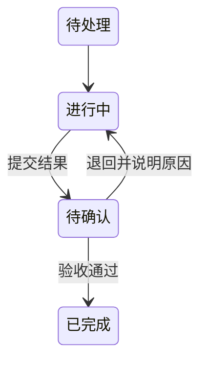
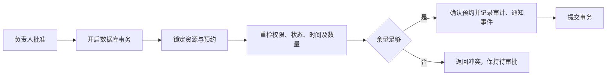
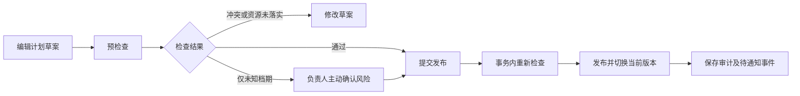
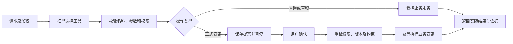

# Silencio Set · 关键流程与异常处理

版本：D0.15  
状态：已确认四批核心流程，覆盖基础业务、资源计划、通告及Diane审批恢复；具体接口和运行配置待细化。

## 1. 统一约定

数据库事务保护正式数据的原子变化，不假设PostgreSQL、Redis、本地文件和RabbitMQ可以组成同一个本地事务。跨存储通过明确状态、唯一执行标识、待投递记录和恢复检查协调。

对用户显示已受理、处理中、成功、失败等实际状态，不把消息发送成功当成业务完成，也不把邮件服务接受投递当成用户已经收到。后台任务有限重试，具体次数和超时随后续任务配置确定。

## 2. 邮箱注册与登录

### 2.1 注册正常流程

1. 用户输入邮箱，请求注册验证码。系统校验邮箱和频率限制，生成有用途及请求标识的短期验证记录，并安排邮件发送。
2. Worker发送前检查该请求仍有效，避免重发后投递过期验证码；页面显示实际发送状态，不承诺送达收件箱。
3. 用户提交验证码，服务端检查用途、请求、有效期及次数，在Redis中原子完成消费并创建绑定该邮箱的短期注册凭证。
4. 前端携带注册凭证和密码完成注册。服务端验证凭证及邮箱绑定，生成密码散列，在PostgreSQL事务中创建账号与凭证消费记录。
5. 数据库提交后返回成功；后续清理Redis中的短期记录。Redis清理失败不撤销已创建账号，数据库唯一消费记录防止重复创建。

短期凭证使用不可预测的随机值，服务端按摘要关联，不把它当作登录会话。密码和凭证不写入普通日志。验证码阶段无需暂存用户明文密码。

同一凭证重复请求先验证有效性，再查已提交的消费结果；已成功时返回对应注册完成状态，不再次创建账号，也不借重试覆盖密码或自动授予登录会话。数据库未提交时可在凭证有效期内重试。验证码兑换响应丢失且无法取得凭证时，允许重新获取验证码，不凭邮箱直接补发有效凭证。

### 2.2 登录及会话

采用邮箱和密码登录。密码使用Argon2id散列，并由成熟实现管理随机盐及参数编码；具体工作参数在安全与性能配置中确定，不自行实现散列算法。

登录成功创建新的随机服务端会话标识，Redis保存会话状态，浏览器通过HttpOnly Cookie持有标识。Cookie限制作用范围，设置适合部署方式的SameSite策略；HTTPS环境启用Secure。仅本地HTTP开发配置可不设置Secure，该例外不能带到对外HTTP服务。

修改状态的请求验证CSRF令牌及适用的来源约束，SameSite只是附加防护，不能代替CSRF校验；HttpOnly会话Cookie与供前端提交的CSRF令牌分开设计。登录等认证状态变化时防止会话固定，退出使服务端会话失效。会话有效期、密码规则和CSRF传递字段在认证接口中补定。

### 2.3 异常及恢复

首次登录新增资料补全步骤：登录及本人资料接口返回完成状态，未完成进入昵称填写页；保存1—30字有效昵称后才能进入剧组、接受邀请及使用Diane。服务端对未完成资料的业务请求返回`PROFILE_INCOMPLETE`，允许本人资料获取、保存、CSRF及退出。注册不再要求昵称，头像及学校不设必填；昵称与完成时间在同一事务保存，多窗口修改检查资料版本。邀请登录后的补全流程保留待处理入口但不延长邀请有效期，也不自动接受邀请。

| 情形 | 处理及状态 |
|---|---|
| 邮件发送失败或延迟 | 有限重试并更新任务状态；请求已失效时停止发送旧验证码，用户可按间隔重新请求 |
| 验证码错误、过期或超限 | 拒绝兑换，记录必要限流信息，提示重试或重新获取；重发后旧码不能使用 |
| Redis不可用 | 暂停注册验证或会话校验，不绕过认证；已有数据库成功记录不回滚 |
| 邮箱已注册或并发注册 | 唯一约束阻止第二个账号；对外提示采用统一策略兼顾账号枚举防护，不泄露其他账号资料 |
| 注册提交失败或响应丢失 | 数据库已提交则通过有效凭证及消费记录定位结果；未提交则在有效期内重试，过期后重新验证 |
| 密码错误、账号停用或会话过期 | 拒绝登录或业务访问，登录失败限流；不区分泄露敏感账号状态的错误详情 |
| CSRF检查失败或退出后继续访问 | 不执行业务修改，要求重新获取合法状态或登录 |

### 2.4 验证点

验证验证码重发、重复消费、注册并发和数据库回滚；确认同一凭证不会创建两账号或覆盖密码。检查会话Cookie属性、退出失效、CSRF拒绝、密码散列和日志脱敏。验证码与注册凭证有效期等参数确定后补充边界测试。

## 3. 文件上传与剧本解析

文件先写临时区，验证后转入私有位置；数据库提交文件元数据、版本、解析任务与待投递记录后，后台才可处理。文件与数据库不具备原子提交，需要检查无引用文件和缺失文件。

正文先完整提取并检查格式、长度及顺序，再保存有序段落并切换到待检查；中间结果不作为完整成功结果展示。用户确认前可以修正内容，确认后段落固定，再修改创建新版本。

| 情形 | 处理及恢复 |
|---|---|
| 文件已落盘但数据库失败 | 不提供业务访问，由恢复检查识别并清理无引用文件；不删除仍在上传或被有效记录引用的文件 |
| 数据库有记录但文件缺失 | 标记失败并提示重新上传，不形成有效剧本版本 |
| 文件损坏、加密或为扫描PDF | 返回具体限制，允许换格式或粘贴正文；不暗示已经执行OCR |
| 提取为空、超限或失败 | 保留失败类别，当前工作版本不变，不将半份正文转为待确认 |
| Worker崩溃或消息重复 | 检查任务及版本状态后恢复；已完成解析不重复写段落，未完成结果不对外生效 |
| 用户发现正文阅读顺序错误 | 确认前修正并复核引用；无法可靠修正时重新上传，已确认内容不覆盖 |

访问始终由后端鉴权，原文件名不直接构成服务器路径。验证应覆盖DOCX、文本型PDF、TXT及非法输入、文件丢失、解析中断、重复任务和旧版保留；内容正确性按需求6.3检查。

## 4. 任务提交、验收与退回

取消作为另行校验的业务操作处理，不以状态图省略它；已完成等状态是否允许后续动作由对应接口规则明确。

1. 提交结果时检查成员身份、负责人及任务版本；创建提交记录和将任务切换为待确认，在同一事务完成。
2. 验收时检查确认人及当前待审核提交；通过则更新提交结果和任务为已完成，退回须填写原因，任务恢复进行中。
3. 再次提交创建新记录，保留旧内容及退回原因。
4. 对应通知的待投递记录与业务状态在同一事务保存，提交后异步通知。

任务实现补充：取消待确认任务时，将当前提交记为`cancelled`并保留取消经办人与关闭时间，不伪造确认人的退回结论。站内消费者已接入，通知、接收记录及事件消费标记同事务提交，明确区分已读、知悉与业务验收；尚未完成真实依赖联调。见[任务说明](../development/tasks.md)及[通知与交接说明](../development/notifications-and-handover.md)。

| 情形 | 处理及恢复 |
|---|---|
| 两次同时提交 | 锁定任务或使用等效并发控制及状态检查，只接受一次有效提交，不生成两个当前待审结果 |
| 同时验收或重复审核 | 仅首次有效审核生效；相同请求可返回已有结果，冲突决定拒绝并要求刷新 |
| 提交与取消竞争 | 在事务内协调，不留下已取消任务仍有可执行待审提交的状态 |
| 审核旧提交或版本不匹配 | 拒绝修改，提示刷新当前提交，不静默覆盖 |
| 负责人或确认人已退出 | 阻止其继续操作，授权人员先处理责任交接；历史记录保留 |
| 通知服务或队列失败 | 不回滚已完成验收，保留待投递事项并重试，不重复验收 |

验证应覆盖正常提交、通过、退回后重提、权限拒绝、并发审核、取消竞争及通知故障。锁定顺序、数据库条件及请求幂等键在事务与接口设计中进一步落实。

## 5. 资源预约、借还与并发处理

### 5.1 申请及批准

申请时检查权限、字段及资源类型，创建待审批预约并记录通知事件；可以展示余量，但不承诺占用，最终以批准时检查为准。

影响排期的写操作先锁定所属剧组，再按资源ID固定顺序锁定相关资源和业务记录，详见6.2；预约批准、数量调整、预约变更及相关借还遵守同一规则。不能只锁定各自预约行，否则两个请求仍可能同时读到旧余量。事务内重检当前审批权限和版本，不依据Redis缓存批准。

按时间段计算同时占用峰值，区间按起始包含、结束不包含处理，相同时间点先结束再开始。例如资源总量2，已有09:00—10:00数量1及10:00—11:00数量1，新申请09:00—11:00数量1可批准，已有同时占用最多为1。不能将所有相交预约简单累加。

### 5.2 修改、取消及停用

| 操作 | 处理及一致性要求 |
|---|---|
| 修改待审批申请 | 修改内容并更新版本；审批者看到旧版本时拒绝审批并要求刷新 |
| 修改已确认预约 | 创建待审变更，原预约继续有效；批准时排除自身旧占用并检查新安排，成功后在同一事务替换，不先释放旧预约 |
| 变更被拒绝或已过期 | 拒绝不改变原预约；原预约版本已变化时变更申请失效，重新提交 |
| 取消已确认预约 | 检查已借出和当前计划引用，存在依赖先处理，不直接释放；历史及实物责任保留 |
| 减少资源总量 | 新总量不得低于未归还数量，也不得低于未来已确认预约的同时占用峰值；不足时拒绝变更 |
| 停用资源 | 阻止新增批准和借出，提醒原有安排；已有预约和借还记录保留，仍允许归还 |

资源数量及预约变更需尊重已有借出和计划关联，不允许新安排使已发生借出失去依据。与计划版本切换相关的处理顺序在下一批流程中细化。

### 5.3 借出与分次归还

借出时开启事务，按统一顺序锁定资源与预约，检查预约已确认、资源未停用、当前处于预约区间、累计批准数量及实物余量，保存借出及审计后提交。需要提前取设备时，应先把准备时间纳入预约并批准，不能绕过时段限制。

归还时锁定资源及对应借出记录，检查剩余未归还数量，新增归还记录并记录审计。累计借出不超过预约批准数量，累计归还不超过对应借出数量；预约过期或资源停用不妨碍真实归还登记。

借出与归还使用请求幂等键，同一请求成功后重复提交返回已有记录；相同键携带不同内容时拒绝，不能当作新操作。同一预约的占用及对应借还不能重复计算。时间预约成功不保证设备已归还，实际借出还需检查实物剩余数量。

### 5.4 逾期及影响提醒

定时检查未归还数量及预计归还时间，超时且仍有未归还数量时标为逾期，提醒借用人及资源负责人，并提示可能受影响的后续预约和计划。通知按逾期事件及接收人去重，任务重复执行不反复创建同一提醒。

归还后重新检查并解除已经解决的提醒，不因逾期自动取消后续预约或修改拍摄计划。提醒只是风险提示，不等于未来实物一定不可用。

### 5.5 故障与恢复

| 情况 | 处理 |
|---|---|
| 两次同时批准竞争预约 | 通过共同资源锁及事务内重检协调，不超量批准 |
| 审批所见内容过期 | 返回版本冲突，要求刷新后重新确认 |
| 死锁或锁等待超时 | 回滚整个操作，受控重试；仍失败时提示稍后重试，不留下部分批准 |
| 数据库成功但响应丢失 | 通过请求幂等键及正式状态返回已有结果，不再借出、归还或批准一次 |
| Redis失效 | 不影响数据库最终判断；概览查询受控回源，不绕过认证与限流策略 |
| RabbitMQ不可用 | 已提交业务保留，Outbox恢复后投递通知；不因通知故障再次执行批准 |
| 逾期检查任务重复 | 根据状态、事件及接收人唯一键去重 |

验证应覆盖上述峰值例子、同刻边界、并发批准、已确认预约变更的拒绝与失效、提前借出拒绝、重复及分次归还、停用后归还和通知故障。具体数据库锁语句、超时及重试次数在事务与运行配置中落实。

## 6. 拍摄计划、跨日安排与通告发布

### 6.1 计划发布

预检查只用于辅助修改，不是发布许可。正式发布检查当前发布权限、草案版本及其依据的原发布版本，核对场戏修订已确认、人员及转场时间、已知不可用档期、场地与可复用资源确认预约、数量覆盖和停用情况。

未归还记录按实物风险提示，不将全部未来预约一律判定失败；根据实际时段和数量判断是否已经构成阻断条件。未知档期只能按需求FR-07主动确认，确认清单必须仍与当前数据匹配，不能豁免已知冲突。

事务内完成检查、确认适用性、版本发布、当前指针切换以及审计和待通知事件写入。失败回滚，不出现已知冲突未处理却显示发布成功的状态。

### 6.2 剧组级排期协调

本地小项目先采用剧组级排期协调锁，以剧组数据库记录为共同入口：先锁定剧组，再按固定资源及业务记录顺序检查与修改。相关写操作包括计划发布、成员档期更新、预约批准和变更、资源数量调整及停用等；影响发布权限或成员有效性的变更也需与发布检查协调。

普通查询不持有该锁，不能将剧组锁保持到等待用户确认、模型调用或邮件发送结束。后续如实测发现锁竞争，再按验证结果细化粒度，当前不引入分布式锁。

成员仍有权修改本人真实档期；与已发布计划冲突时保留新档期并标记计划待复核，不强制维持旧可用状态。剧组内冲突检查不宣称已覆盖未授权的其他剧组或系统外安排。

### 6.3 新旧版本及资源顺序

发布新版保留旧版，只在同一事务中切换本计划当前发布版本；新版检查排除本计划旧版安排，同时检查其他当前计划。草案及历史版本不重复计入正式人员安排或资源分配。

资源占用以确认预约为依据，场次分配只核对该预约的使用，不再次增加预约占用；共享预约的当前场次按同时使用数量检查。复制草案不创建预约，发布计划也不自动批准、修改或取消预约。

当前计划所引用的预约不得直接调整成无法覆盖原安排。替换资源先批准可用的替代预约，再发布新计划，最后处理已无依赖的旧预约；条件无法落实时保持草案，不强行发布。此阶段不增加跨模块自动调度或临时绕过审批的能力。

### 6.4 跨日通告归属

场次归入按Asia/Shanghai计算的开始日期对应通告单，结束时间显示完整日期。例如10月21日23:00至10月22日01:00的场次，主条目进入10月21日通告，明确标出次日结束，不在次日再生成正式场次。

档期、预约和冲突检查始终使用完整跨日区间。生成次日通告时提示前一日存在延续拍摄，提醒负责人检查集合及休息安排；该提示不是新场次，也不重复计入占用。

### 6.5 通告生成、审核及发布

选择已发布计划及日期生成草案，负责人补充集合、联络及注意事项，提交审核后发布。发布时验证来源计划仍为当前版本、内容自审核后未修改、操作者有权、必填信息齐全且安排与引用一致。

审核后修改内容需重新审核；发布后修改形成新版本。网页发布与PDF导出分开，PDF严格绑定版本，导出失败不回滚已发布网页，不返回旧版PDF冒充新版。页面和旧链接均检查有效状态，展示过期或待更新标识及当前安排入口。

| 计划更新情形 | 通告处理 |
|---|---|
| 当日场次、时间、地点、人员或资源变化 | 对应通告标为待更新，负责人修订、审核并发布 |
| 当日安排相同但来源版本变化 | 标为需复核，可沿用内容生成新版本，不要求重录，仍需确认来源 |
| 场次移动日期 | 原日期和新日期均复核 |
| 原日期已无拍摄 | 旧通告不再作为有效安排，提示原接收成员该日期安排已撤回；历史内容保留 |
| 新通告发布 | 建立新版本通知及确认，旧版确认不能自动沿用 |

通告待复核不等于计划发布回滚；计划仍为正式安排依据。有效状态更新及待通知事件与版本变化保持一致，不能仅依靠异步通知判断旧通告是否过期。

### 6.6 异常及验证

| 情形 | 处理 |
|---|---|
| 预检查后档期、资源或权限变化 | 事务内重检，拒绝沿用过期结果，要求刷新并按新情况确认 |
| 两人发布不同草案 | 检查草案及原当前版本，只允许基于有效前提发布，后提交者不能静默覆盖先发布结果 |
| 发布成功但响应丢失 | 按发布请求幂等键返回已有结果，不产生第二次发布事件 |
| 计划或通告通知队列失败 | 正式发布保留，Outbox恢复投递，页面直接显示有效状态 |
| PDF失败或重复任务 | 展示真实导出状态，按版本定位有效结果，不回退到旧PDF |

验证覆盖当前版本替换、其他计划冲突、未知档期数据变化、可复用资源未批准、共享预约数量、跨日归属、场次移日、当日取消、重复发布和旧链接提示。具体SQL、来源差异字段及模板必填项后续细化。

## 7. Diane调用、审批恢复与失败处理

### 7.1 请求与工具范围

接收请求后检查登录、剧组成员状态及对话归属，创建或按请求键定位`agent_runs`，再调度AI Worker。用户与剧组范围来自可信服务端上下文，不能由模型参数自行声明。

| 工具类别 | 示例 | 执行边界 |
|---|---|---|
| 查询 | 任务、档期、资源和计划 | 当前权限范围内查询，返回必要记录及版本依据 |
| 分析与草稿 | 筹备缺项、拆解、文字分镜 | 保存草稿或建议，不自动确认或发布 |
| 变更提案 | 批量任务、调整计划、申请预约 | 保存提案，等待授权人确认，沿用正式业务规则 |

工具按当前任务及权限提供，名称和参数通过允许清单及结构校验，不暴露任意SQL、系统命令或服务器路径访问。相互独立的只读调用可以并行，有关联的数据需明确版本；涉及修改的调用按业务顺序处理，不能由模型并行改写同一计划或资源。

申请预约只创建待审批申请，不能代替资源负责人批准。计划草案修改与正式发布分别表达，不能用含义不明的工具绕过发布确认。

### 7.2 正常调用路径

### 7.3 审批与恢复

1. 数据库保存提案、目标版本、影响和冲突，建立待确认状态。
2. 保存LangGraph检查点并关联执行，释放Worker，页面展示数据库中的提案；不持有数据库锁或继续调用模型等待用户。
3. 用户确认、拒绝或取消时，后端验证身份、权限和当前提案状态；批准后安排恢复任务。
4. 恢复任务以数据库审批及执行记录为依据，重检当前权限、版本、资源及冲突，再调用同一业务服务。
5. 正式业务变更、业务执行标识、实际结果及成功审计在同一数据库事务保存，然后将结果交回模型生成回答。

若提案已保存但检查点写入失败，记录故障并从已有提案恢复，不因重试再次生成等价提案或自动批准；检查点状态不能单独证明审批成功。

同一对话同一时刻只推进一条执行，后续请求按序处理；待确认期间允许查看、拒绝、取消或处理当前执行的澄清，不并行覆盖上下文。顺序协调通过持久状态及短事务完成，不长期持有数据库连接等待用户。后台任务结束不等于整次Agent执行完成。

### 7.4 防重复与数据变化

| 情形 | 处理 |
|---|---|
| 重复确认同一决定 | 返回已有审批或执行结果，冲突决定拒绝 |
| 批准后权限撤销或成员退出 | 执行前拒绝，不能因曾经批准继续执行 |
| 目标版本、档期或资源变化 | 提案失效，重新检查并生成待确认提案，不静默改变已批准内容 |
| Worker业务提交后崩溃 | 根据`execution_key`查数据库结果，已经完成则复用，不重复修改 |
| LangGraph恢复重新经过节点 | 先查持久业务状态，不能将节点重入等同首次调用 |
| 用户取消时部分业务已提交 | 如实展示已完成部分，后续补救走普通业务流程，不宣称自动撤销 |

必须原子完成的操作使用单事务，不能为绕开失败拆分执行；允许分别完成的独立操作逐项记录结果和稳定执行标识，完整批次键与子操作的映射在工具接口中明确，不能笼统显示全部完成。

### 7.5 模型故障、预算与安全

网络超时及模型限流按配置有限重试，参数错误、权限拒绝和业务冲突不通过重复模型调用强行解决。达到token预算、轮数或超时限制时停止，保存已完成结果及原因；失败和重试也记录用量。

业务已提交但模型回答失败时，页面根据后端业务结果提供确定性反馈，并标明回答生成异常，不重新执行业务来补一句回答。执行整体失败状态不能掩盖已提交的提案或业务结果。

剧本、上传文档和工具返回内容中的指令视为资料，不允许扩大权限、增加工具或跳过审批。日志及错误脱敏，保留实际模型标识、各轮用量、工具结果与重试，不存密钥。

### 7.6 审计失败与验证

正式业务变更与成功审计共同提交；成功审计写入失败则回滚该次变更。权限拒绝或业务回滚后的失败审计另行写入；再次失败时保留脱敏运行错误并提示排查，不伪称审计完整，也不能以写失败日志为由重做原业务。

验证包括越权查询、提示注入、非法工具参数、拒绝与重复确认、过期提案、成员退出及权限改变、检查点失败、Worker重启和重复恢复、业务成功后模型失败、预算停止、重试token汇总及审计失败回滚。

## 8. 数据设计同步与待细化事项

本轮在数据设计中补充`registration_receipts`，用于将短期注册凭证的唯一消费结果与账号创建绑定；Redis保存短期验证、注册凭证和会话。密码散列确定为Argon2id，Cookie会话和CSRF防护按本章实施。

资源流程补充`reservation_change_requests`，保存已确认预约的待审变更；借出、归还及审批记录补充请求幂等字段，支持响应丢失和重复消息恢复。

计划与通告版本增加发布幂等标识，通告发布流程和有效性分开表示，支持待复核、被新版替代和日期安排撤回；不修改历史正文和原有确认。数据约定已同步《03_核心表字段与约束》。

Diane对话增加当前执行引用，明确同一对话顺序推进；提案执行结果与业务变更、成功审计共同提交。后台状态和检查点不替代数据库结果，重试及节点恢复先检查是否已完成。

验证码参数、注册凭证有效期、邮件发送内容的短期安全交付、会话配置、临时文件清理时机、对话调度及恢复任务的具体实现、批次子操作标识及事务语句尚待接口与运行设计细化；本章不构成已实现或已通过测试的声明。

### 8.1 统一降级与界面反馈

已确认的统一fallback策略见[非功能与降级设计](06_非功能与降级设计.md)第2节FB-01—12，各业务沿用本章事务和幂等规则，不重复维护另一套恢复路径。模型故障回到普通页面或人工草稿，解析失败提供替代输入，导出失败保留网页版，队列失败保留已持久受理任务与Outbox。认证依赖故障不得免认证，数据库故障不得使用旧缓存审批或发布；普通缓存回源仅在身份可验证且容量受控时允许。

保存响应丢失须核实实际结果或使用原幂等键恢复，不能直接判定业务失败并换键重做。业务已提交但模型回答失败时返回实际业务结果，不再次执行。通告页面分开显示发布、通知投递及成员知悉状态，采用UI参考V1的排期内发送入口；局部错误就地提示，旧资料必须标注版本和有效性。

故障恢复测试依据策略表的触发、提示、边界与验证项执行，模拟与实测分开记录；未完成测试不声明降级已生效。

### 8.2 缓存、任务与重试配置衔接

缓存防护、通知／文档／Agent队列划分、消费确认、执行租约及重试责任见《06_非功能与降级设计》第5—9节。结果持久提交前不提前确认消息；执行接手须取得当前执行权，旧执行不能覆盖新结果。消息可能重复，租约与检查点均不能代替正式业务幂等标识。

重试回滚完整事务后再执行校验，不叠加SDK、业务层及Celery的无边界重试。人工等待释放Worker并独立计时，恢复后仍检查提案及剩余预算；取消不撤销已提交业务。具体超时、并发、租约和次数尚待环境测试固定，不能将规则描述当作已通过故障测试。

### 8.3 安全与备份恢复衔接

安全配置及备份恢复见《06_非功能与降级设计》第10—13节。首期维护窗口暂停写入、消费及清理，取得数据库和文件配套备份，恢复后核对引用和业务记录、使旧会话失效，再受控恢复任务。每日备份、恢复点24小时及恢复时间4小时均为待验证目标。

从旧备份恢复后，邮件及模型等外部副作用可能已发生而本地记录已丢失，不能只依据恢复库无记录自动重放。结果不明先核实或人工处理，旧提案不自动批准；恢复演练和实际耗时另行记录，不把备份文件存在视为恢复成功。

### 8.4 创作退回与通告接收人闭环

场戏拆解和分镜只允许草稿编辑；送审后冻结编辑，通过后冻结正式内容，退回为已否决。具有编辑权限者调用明确的`reopen`接口恢复草稿并递增版本，已确认内容只能创建新版本。拆解整体与内部修订状态同步，审核及重新打开与编辑协调，历史审核及被审内容保留。接口见D05第10—11节，审核记录见D03第9—10节。

通告来源当日参与者为必选接收人，可增加其他在组成员，集合与内容一并审核。集合修改也使旧审核失效，发布时重检在组、必选覆盖及审核集合；不匹配整体拒绝，不静默漏发。发布接收快照、状态、审计与Outbox同事务保存。异步失败只补投原通知，新增接收人需新通告版本重审。接收记录不替代岗位授权，历史快照不授予离组成员继续访问权。接口见D05第17节，集合与快照见D03第19.3节。

### 8.5 首批详细接口与预检标记

本人资料、资源审批及计划预检／发布的完整字段、响应与错误码见D05第22节。预约通过与拒绝均持久幂等，审批读取原结果仍检查当前访问权。计划预检以D03第18.1节记录成员、草稿、来源、关联检查集合和未知项；发布在协调锁下比较新增、删除及状态变化，不能仅凭旧行版本或客户端确认放行。

首次发布的原当前版本显式null，未知项逐项明确确认。发布已提交但响应丢失时先定位同键结果，再决定是否进入新发布校验，不因首次发布造成的状态和标记变化拒绝合法恢复，也不再次执行业务。

### 8.6 通告及提案决定契约衔接

通告接收集合、审核及发布、提案确认／拒绝的字段与错误码见D05第23节。通告审核备注最多500字，退回必填；发布重检来源、审核内容和接收集合，首次当前指针显式null。同键重试恢复原结果，不因第一次成功后的版本递增重复审核、发布或清除回执。

提案接受返回202，仅代表决定与恢复任务已持久受理：状态由待确认转为`confirmed`，数据库事务同时保存决定、任务、幂等结果和Outbox；实际执行后才是`executing`及最终结果。拒绝返回200，不执行拟议变更。Worker仍重检权限和来源，队列等待期间条件变化不能沿用批准绕过约束，Broker不可用不伪装执行成功。

### 8.7 内部服务及外部适配衔接

逻辑服务、Qwen及SMTP适配契约见D05第24节。业务服务统一事务与权限，内部调用不新增HTTP微服务，Worker重新验证当前上下文。模型工具建议不直接成为执行结果；限流、超时及非法响应统一分类，适配层重试不与SDK或Celery重复放大。

验证码及邀请凭证通过D03第2.2.1节短期加密载荷交给发送Worker，任务和Outbox只保存引用。过期、丢失或解密失败停止，不从摘要恢复明文；Redis和数据库跨存储失败按明确状态处理。邮件accepted仅为服务接受，unknown不宣称未发送；已在途旧邮件无法保证撤回，但验证端拒绝失效凭证。密钥、载荷TTL及真实模型／邮件配置仍待验证。

### 8.8 租约、资源范围及提案分发

执行租约落点为D03第25节，续租和写回检查当前token，接手不得复活旧token，业务写入仍检查稳定执行键；人工等待结束当前后台阶段，外部不明结果不盲重放。资源权限加D03第12.3节具体范围和负责人约束，交接撤销旧审批范围；提案按D03第23.1节分发，分发不授权，多候选不是会签。D05第25节定义相应调用与检查入口。

### 8.9 变更提醒、通告模板与图片

D03第29节问题及检查状态与通知分离，源变化标记待检查，旧检查结果不能将新变更误标已就绪。来源复核保存具体当前工作稿及旧关联结论，不改历史正文；通知已读不解除问题，正式发布仍实时检查。通告失效等原有同步规则不延迟到后台分析。

通告模板字段见D03第19.2节及D05第26.2节，送审和发布要求集合时间、地点完整，集合不晚于首场，跨日显示完整日期；网页与PDF同源。照片见D03第12.2节、D05第26.3节，实际解码校验、方向规范和EXIF清理成功才成为可用展示文件，关联数量事务内检查，不默认模型分析。数值是设计初值，资源消耗及恢复测试尚待执行。

### 8.10 待确认列表与来源人工复核

D05第27节补独立提案列表、影响问题列表、受控重新检查及来源复核。读取仍按当前授权过滤，空列表不表示全部就绪；重新检查202仅受理，按当前检查修订合并去重。来源复核绑定问题版本与当前工作稿、说明1—1000字，still_applicable事务内重检后仅解除该项，needs_revision保持未解决；不改旧来源，不确认草稿，不绕过冲突。工作稿再次变化返回SOURCE_VERSION_CHANGED，要求重新核对。

## 9. 安全参考

- [OWASP密码存储指南](https://cheatsheetseries.owasp.org/cheatsheets/Password_Storage_Cheat_Sheet.html)：密码散列及成熟实现选择依据。
- [OWASP会话管理指南](https://cheatsheetseries.owasp.org/cheatsheets/Session_Management_Cheat_Sheet.html)：服务端会话及Cookie保护依据。
- [OWASP CSRF防护指南](https://cheatsheetseries.owasp.org/cheatsheets/Cross-Site_Request_Forgery_Prevention_Cheat_Sheet.html)：写操作防护与SameSite边界依据。
