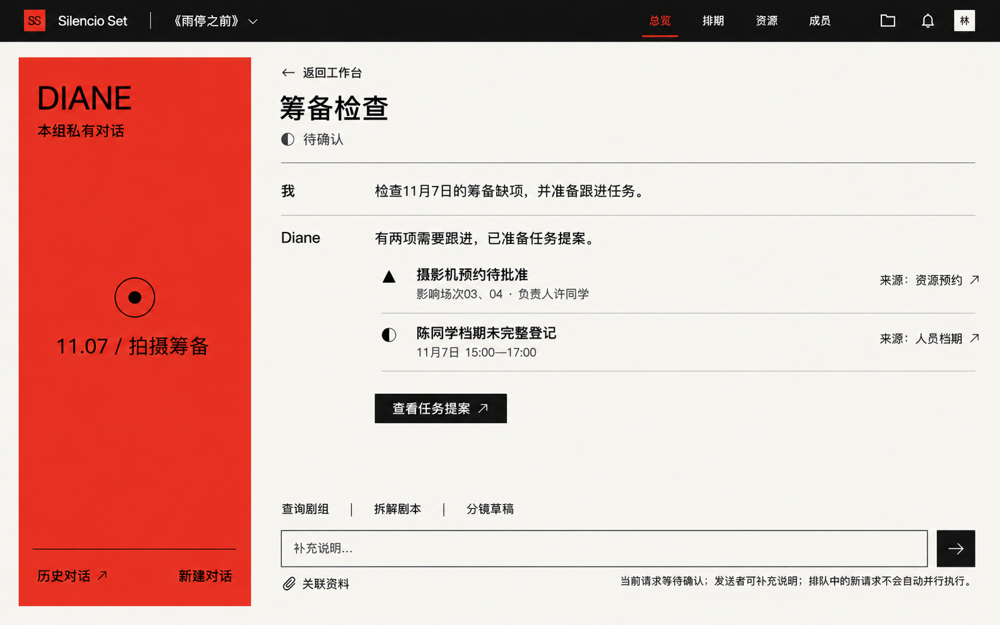
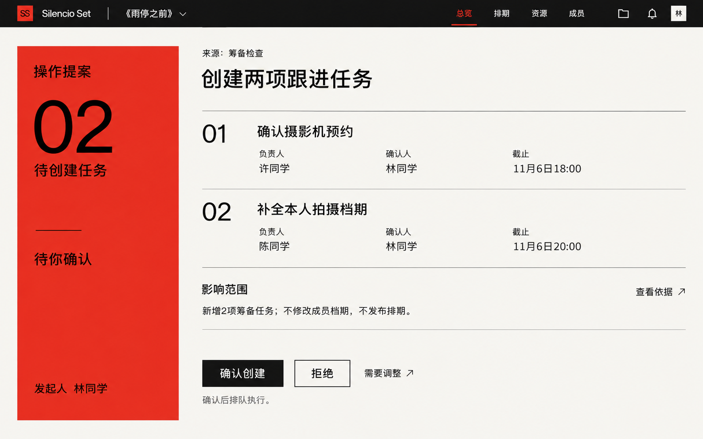
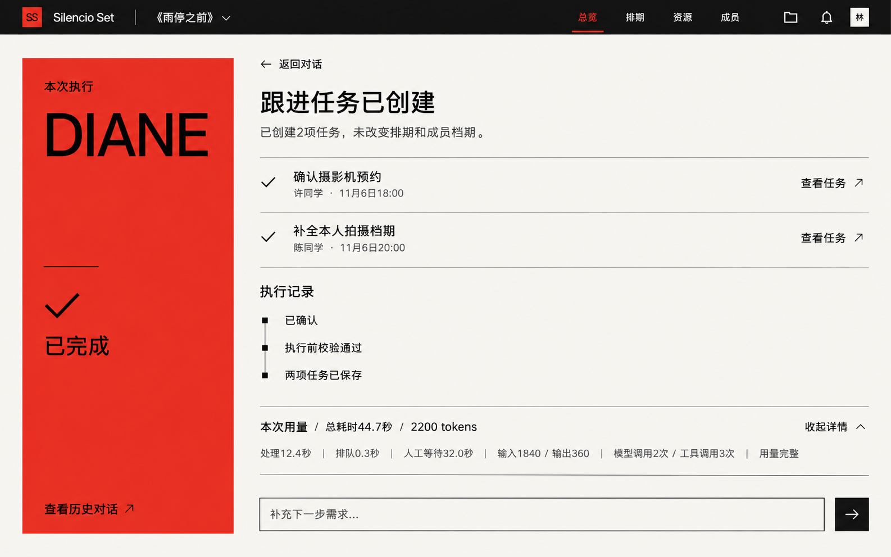

# Diane · UI参考 V1

状态：本轮新视觉方案，采用内置图像生成工具，尚未据此修改前端。日期、人数、耗时及token均为演示数据。

## 设计依据

依据《05_接口设计》第19节、《04_关键流程与异常处理》第7节、《03_核心表字段与约束》第21—24节及《11_页面与交互设计》第9节。沿用[平台UI参考](../ui-reference-v1/README.md)的通高红色面板、黑字、暖白内容区、方角、细线与留白。新增目录记录本轮提案，不覆盖现有业务文档和页面。

## 入口和结构

- 通过工作台的Diane入口打开工作区；一级导航继续为总览、排期、资源、成员，返回入口保留当前剧组与原业务页面。
- 左侧红区展示Diane、当前会话或执行状态。历史对话按需展开，不新增常驻全功能侧栏。
- 右侧对话以用户输入、结论、必要业务依据和对象入口为主；采用文字与细分隔线，不堆叠彩色气泡、发光状态卡或推理日志。
- 查询、筹备检查、剧本拆解及文字分镜草稿共用输入区。关联资料只能选择本人有权使用的本组资料；不默认发送勘景图片给模型。
- 短查询可在业务页的轻量面板完成；长对话、生成草稿与复杂提案展开到本组工作区。此套图主要展示完整工作区。

## 三个关键界面

### 对话与筹备检查

### 操作提案审阅

### 执行结果与用量

## 行为和内容约定

1. **对话页**：结论旁提供经授权的来源对象入口。图片中的“本组私有对话”实现时明确标为“本人私有对话”；同组身份不授予他人对话阅读权。查询结果不自动授权正式修改。
2. **草稿**：剧本拆解和分镜生成结果进入原有可编辑草稿页面，显示来源与审核状态；用户通过普通业务流程送审，不能因AI生成而直接确认或发布。
3. **提案独立审阅**：展示动作、对象、来源版本、负责人、确认人、截止、影响与冲突。确认和拒绝在详情中明确执行；需要调整返回澄清并生成新提案。后端将确认绑定具体提案版本，界面不借输入框替换已经批准的内容。
4. **确认人分发**：创建者可选择符合业务授权条件的审阅人。分发给他人时只展示必要提案，不携带私有聊天；任一有效决定生效后，其他审阅入口显示最新状态。仅查看权限不显示确认操作。
5. **确认与执行分开**：确认后先显示“已确认，等待执行”，Worker实际推进才显示“执行中”；只有业务提交成功才展示“已完成”和实际对象入口。截图中完成指任务创建完成，不表示筹备任务已经被负责人做完。
6. **状态**：排队、执行中、等待补充、等待确认、已完成、失败、已取消以图标和文字展示。排队或执行中允许请求停止；已完成变更不因取消自动撤销。相同对话逐条推进，新请求可排队，当前澄清使用“补充说明”入口。
7. **异常**：提案来源过期、权限变化或冲突提示重新检查；失败保留已完成结果，不提供含糊的“再次执行全部”。部分完成仅适用于允许独立提交的批次，按项展示实际结果。未配置模型时提示未启用，普通业务可继续使用。
8. **用量**：默认仅显示状态、总历时、token和“查看详情”，详情再列排队、人工等待、模型/工具调用与输入输出；未知为空并标记不完整，不能显示0冒充实测。示例处理12.4秒＋排队0.3秒＋人工等待32.0秒＝总历时44.7秒，输入1840＋输出360＝2200 tokens。实际并发阶段不简单累加耗时。
9. **低密度和符号**：红区只承载身份与当前状态，正文一屏聚焦一个主要结果；三角表示问题、半圆表示待确认、勾表示已提交。用量默认折叠，截图第三张为展开状态。无需照片的对话不为装饰强行插图。
10. **手机**：红区缩成简洁上下布局，提案逐项展示，来源与确认按钮保持可达；不按比例缩小桌面长图。

## 视觉落地

所有非图片色块实现为纯色，参考图中轻微生成纹理及偶发文字误差不作为实现规范。页面标题采用常规字号，Diane字标不要求夸张放大。模型内部推理、原始检查点和技术调度说明不进入面向成员的界面。

完整生成提示词见[prompts.md](prompts.md)。

