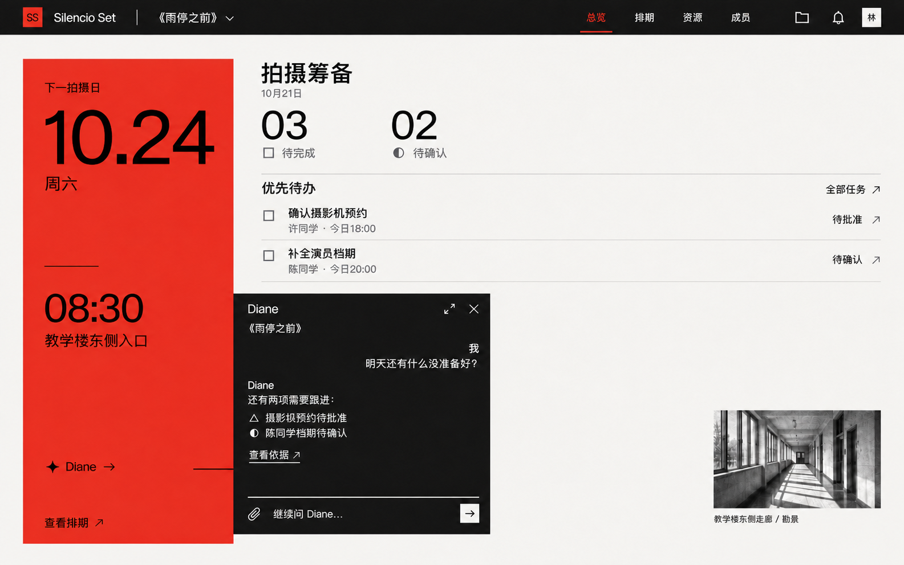

# Diane · 轻量展开式UI参考 V2

本轮调整依据：Diane是轻量助手，入口位于左侧红色模块，点击向右展开黑色聊天矩形。此方向替代V1把日常对话设计成独立大工作区的方案；本轮方向现已落地前端：红区内入口、向右连接的黑色无模态面板、放大／还原及手机单列层；任务提案继续在独立详情中明确确认。

## 交互约定

- 收起时只保留红区内的符号、Diane名称及展开提示，取消右下角重复入口。
- 点击后黑色聊天面板从红区右缘向右展开，与入口有视觉联系；原业务页保留位置、筛选及编辑内容，不加整页遮罩。
- 面板顶部仅展示名称、当前剧组、放大与关闭；关闭为收起，保留本次会话，不等于取消后端执行。
- 对话以简短回答、必要来源链接和输入区为主，不常驻历史列表、用量面板或长提示。
- 放大时增加阅读空间，仍保留返回原业务上下文的路径；手机采用可关闭的单列聊天层，避免桌面位置溢出屏幕。
- 查询直接回复；草稿提供打开原资料编辑页入口；变更在对话中显示提案摘要和审阅入口。复杂提案按既有规则在独立详情核对，明确确认后执行，不能以普通聊天发送替代授权。
- 等待、补充、确认、执行、完成及失败只用必要图标和短文字表达；取消不暗示撤销已经保存的变更。
- 耗时与token放入消息的“执行详情”按需展开，未知用量不填0；对话限本组本人私有，提案分发不泄露整个聊天。

示例日期与内容仅用于构图。实现时红黑色块使用纯色，图片中的轻微生成纹理不作为效果要求。图像由内置图像生成工具生成并做单点修正，完整提示词见[prompts.md](prompts.md)。

## 本次实现与验证

入口位于业务页左侧红色面板下部，取消右下角重复入口。桌面聊天面板左边与红区右边严格对齐，默认 450×480px，桌面放大时与红色面板上下齐平、高度相同，从红区右缘覆盖到视口右缘；不使用整页遮罩、阴影或业务布局挤压。手机在视口内显示可关闭的黑色单列层。

关闭只隐藏面板，保留未发送文字及进行中的查询；切换业务页不清空。问答已按本人／剧组保存到数据库，刷新或切回剧组后可恢复最近对话，也可在“历史与偏好”中切换；连续追问携带受长度限制的近期问答和明确保存的偏好。业务事实仍需本轮工具查询。新对话、历史与偏好为次级操作，不常驻历史列表；未知执行结果通过“刷新对话”读取，不自动重放请求。Enter 发送，Shift+Enter 换行，中文输入法确认文字时不发送。

来源和执行详情默认收起，模型服务与资料发送说明保持可查，首次发送区显示简短提示。查询失败保留输入。任务提案从聊天底部入口打开独立详情，沿用原提案版本、权限、整批原子创建及原决定重试规则，普通聊天发送不能确认提案。

后台聊天启用后，提交先显示排队／生成回答／查询资料，再通过SSE读取保存的结果。收起面板不取消后台执行；重新展开按原请求ID订阅，浏览器验证1次提交、2次订阅且不重复生成。正文尚未逐token输出。

7 项相关组件检查通过，构建通过。Edge 使用模拟问答核对红区入口边界、面板接缝、无页面遮罩、放大／还原、收起保留内容及切换业务页；390px 页面和 366px 聊天层均无横向溢出、无脚本错误。本轮未向外部模型发送资料，未改变后端和业务记录。

### 动效与放大补充

聊天面板从红区右缘向右滑出，展开时以固定裁切容器避免黑色内容掠过红区。放大／还原使用约240ms的位置和尺寸过渡，打开滑出约280ms；系统偏好减少动态效果时取消动效。放大不再限制820px宽度，而是与红色面板保持相同的顶边、底边和高度，仅横向延伸至视口右缘；顶部导航与红区保持可见。窄屏放大覆盖导航下方的整个宽度。

Edge 已实测1440×1000视口：红区右缘378px，放大后的聊天区域为x=378、y=124、宽1062、高876；红区为y=124、高876，两个色块上下边缘完全齐平；还原、收起保留内容，390px视口无横向溢出。检查使用模拟问答，未调用外部模型。
