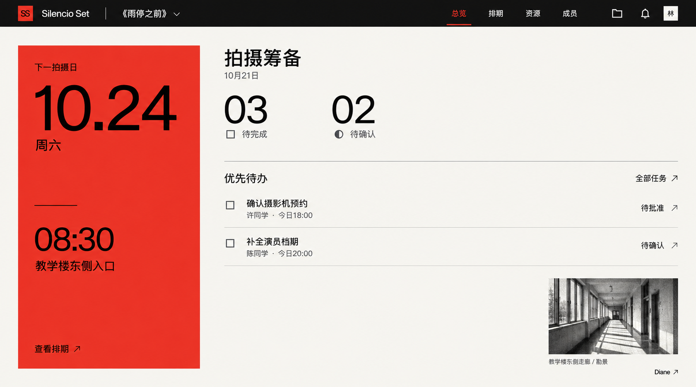
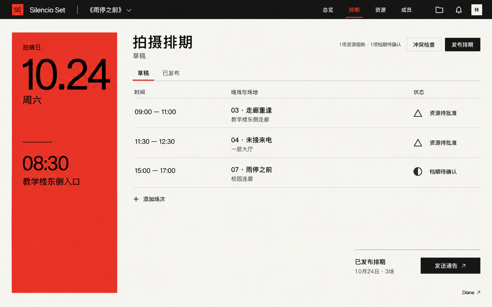
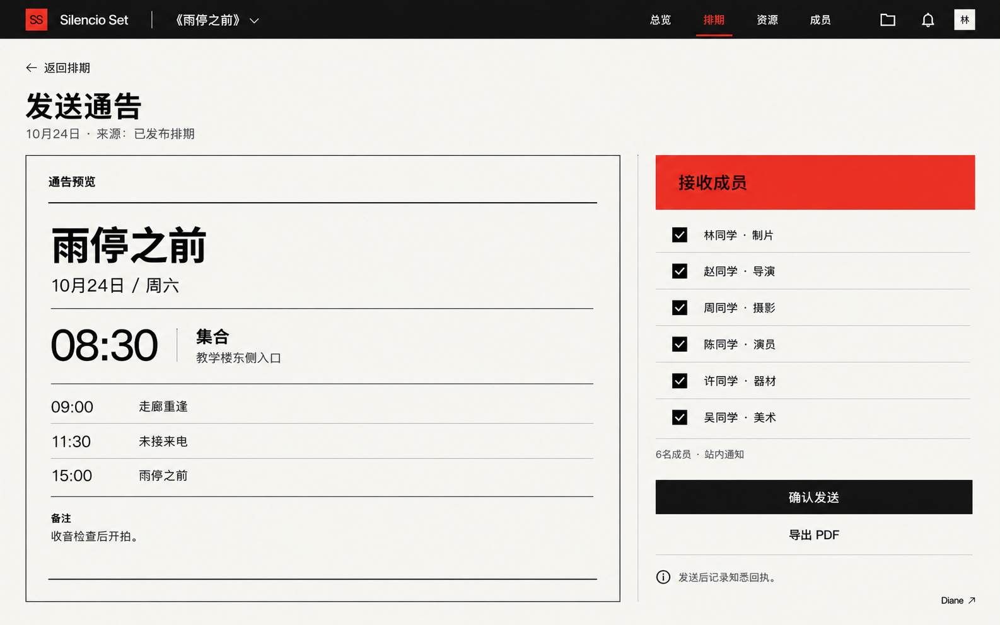
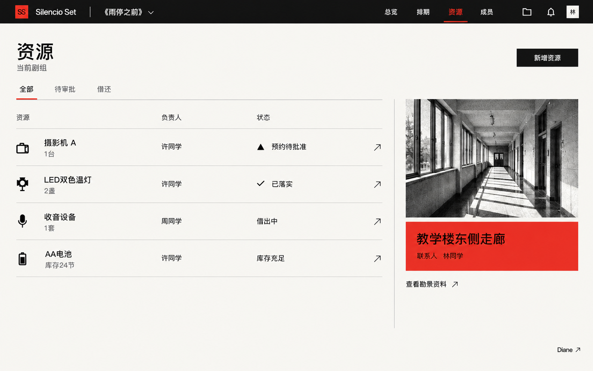
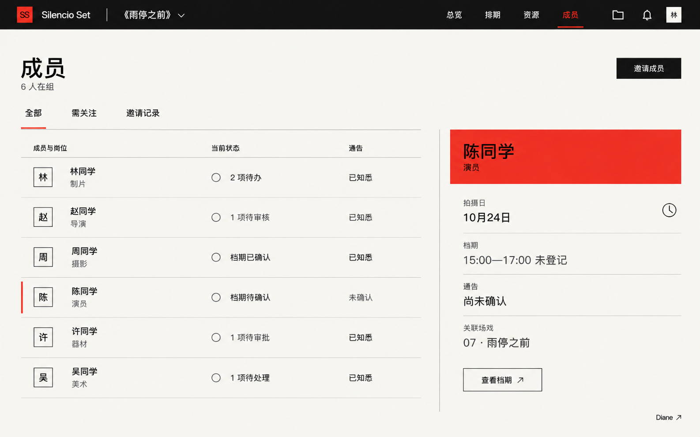

# Silencio Set · UI视觉参考 V1

状态：视觉方向参考。总览、排期、资源、成员与账号页已按本规范调整，并使用真实试用数据完成桌面及手机截图检查。参考图中的示例数据仅用于说明构图。

## 确认的方向

- 国际主义网格与红、黑、暖白配色，方角控件、细分隔线、充足留白。
- 实现补充：红色拍摄区块及红色SS标识使用黑色文字；该规则覆盖参考图中的白字效果。
- 业务页桌面布局采用左侧通高红色面板、右侧标题与业务内容；红块约占主体宽度的四分之一，覆盖接近一屏的主体高度。标题不能放在红块上方而将其压缩成局部卡片；窄屏改为上下排列。
- 账号页红块取消宣传标语，采用黑色`SS / Silencio Set`英文重复斜排铺满，超出部分裁切；属于装饰排版，不干扰表单与屏幕阅读。
- 仅保留必要提示，常规文字不使用夸张压缩字形；符号、图标与经过处理的图片服务于信息识别。
- 实现时色块采用纯色，不加入发光、渐变、投影和彩色状态胶囊；生成图中存在的轻微纹理不作为实现依据。
- 一级导航：总览、排期、资源、成员。剧本、场戏与分镜通过项目资料入口访问。
- 总览只显示待完成及待确认任务数量，优先展示少量待办；集合时间和横线置于左侧红色区中段。
- 通告作为排期内的发送入口，发送前预览、选择接收成员，记录知悉回执。来源必须是有效的已发布安排；保留既有审核与版本校验。
- 成员页查看岗位、档期、待办及通告确认；不能由管理员代改成员档期。
- Diane为后期增强能力，参考图中的入口表示未来位置，未启用时不显示为可用。

## 页面参考

### 试用反馈后的排版约定

- 剧组名称与影片名称在顶部和页面标题区持续显示，手机端保留顶部项目身份。
- 主操作放在模块标题右侧，查询／刷新作为次要操作，退出剧组收进剧组设置。计划和版本选择显示当前选中状态。
- 正式排期采用编辑式只读排版：时间放大，日期与场次编号作为次级索引，场戏、场地和人员按列对齐；桌面行间留白，手机逐场分组。回执操作独立成行，每日通告以粗分隔线和足够段前留白独立分区；草稿进入编辑布局。
- 资源采用统一列宽、行间距和分隔线，手机端逐项展示名称、负责人、状态及详情入口。
- 耗材详情内切换“库存与流水／库存管理权限”。授权用“允许修改／移除修改权限”表达，选择成员后直接确认，不叠加弹窗；负责人转交折叠为可选项。修改库存另开表单时隐藏详情，避免双层弹窗。
- 档期弹窗先选择范围，再编辑时间段、核对保存。已保存登记与规则折叠展示。
- 登录装饰文字采用密集斜排覆盖红块，并在色块边缘裁切。
- 剧组选择采用大号红色序号与分隔线。顶部项目身份及剧组设置支持悬停查看剧组列表，并保留点击入口。
- 总览以“需要重新确认的安排”说明资料变化的影响，入口为“查看待确认事项”。
- 拍摄计划采用宽幅编号列表，版本单独分组为网格卡片：大号红色序号、版次和状态，选中项黑底白字；卡片保留足够高度与间距。资源详情按基本资料、预约记录、时段余量与实物借还分类显示。

### 总览

### 拍摄排期

### 发送通告

### 场地与资源

### 剧组成员

## 生成方式

使用内置图像生成工具，以已确认总览为四张新增页面的风格参考。后续实现需按组件规范确定尺寸和排版，不能将整张参考图作为界面替代。新增页面的完整提示词见[prompts.md](prompts.md)。

Diane 入口及聊天展开以[Diane UI V2](../diane-ui-reference-v2/README.md)为准：入口嵌入左侧红区，黑色聊天矩形从红区右缘展开，不加全页遮罩；复杂提案保持独立详情确认。
