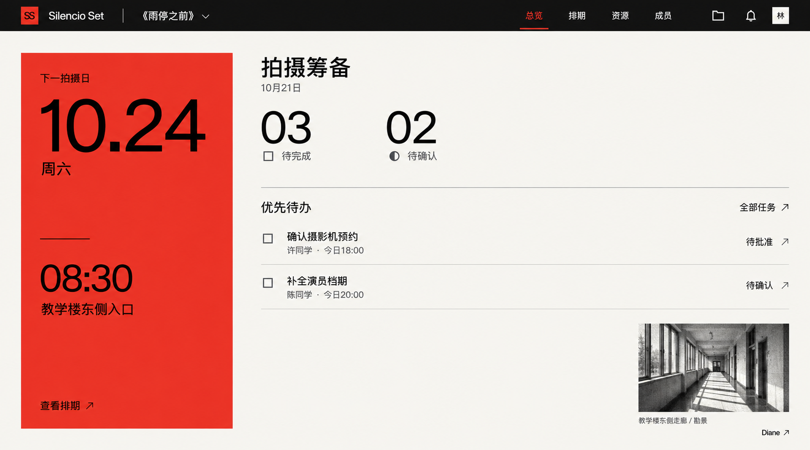
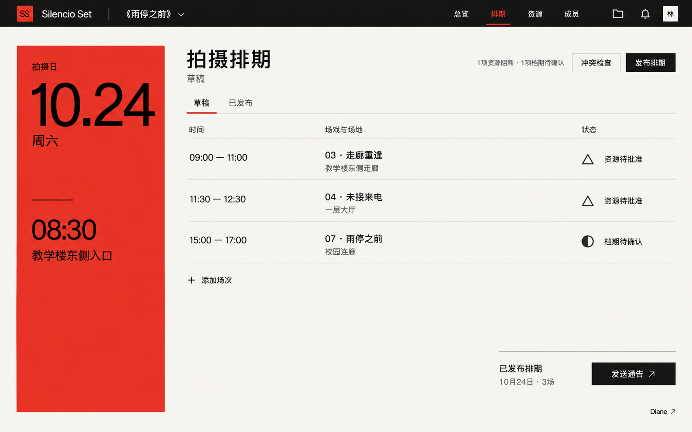
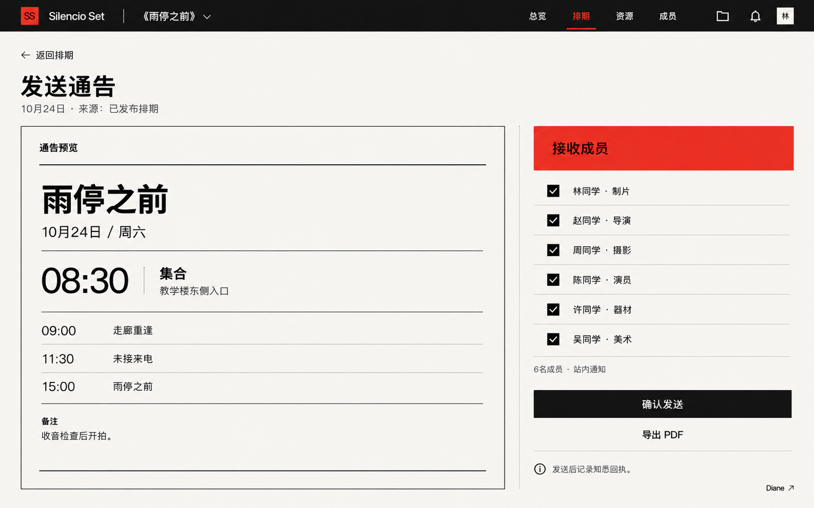
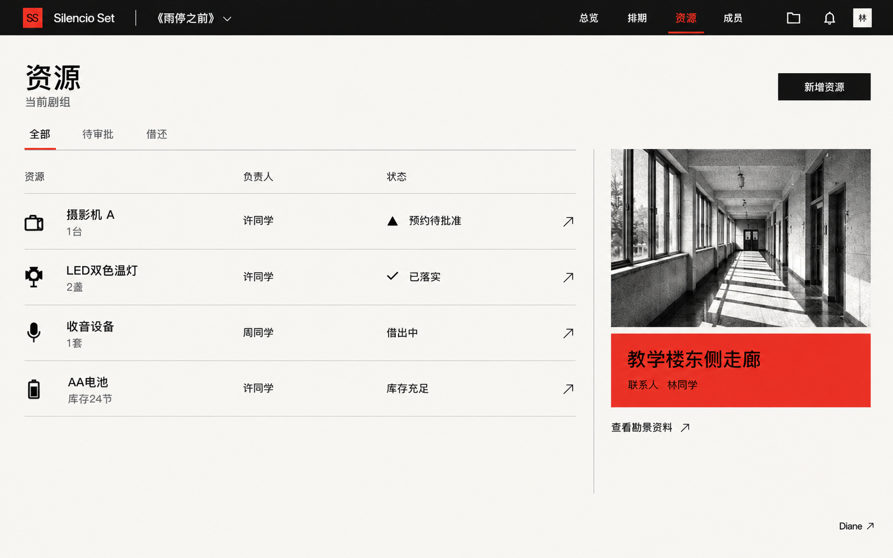
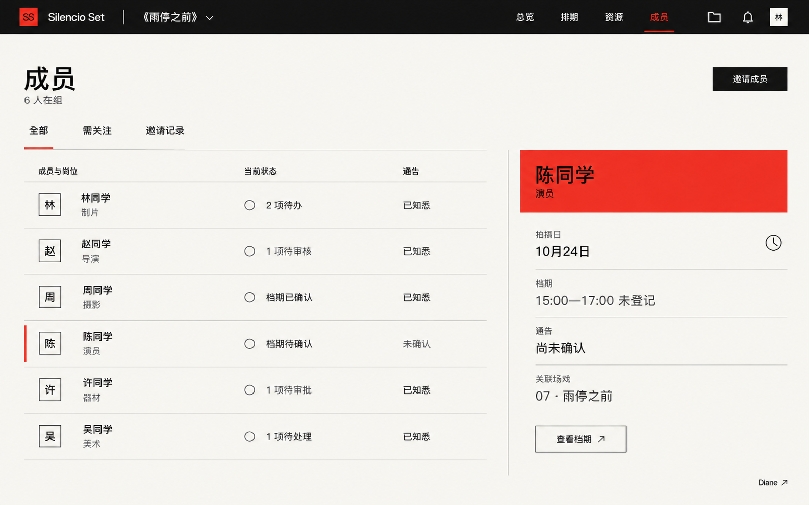

# Silencio Set · UI视觉参考 V1

状态：视觉方向参考，尚未实现为前端页面。示例数据不代表真实剧组；截图不替代需求、接口与权限设计。

## 确认的方向

- 国际主义网格与红、黑、暖白配色，方角控件、细分隔线、充足留白。
- 仅保留必要提示，常规文字不使用夸张压缩字形；符号、图标与经过处理的图片服务于信息识别。
- 实现时色块采用纯色，不加入发光、渐变、投影和彩色状态胶囊；生成图中存在的轻微纹理不作为实现依据。
- 一级导航：总览、排期、资源、成员。剧本、场戏与分镜通过项目资料入口访问。
- 总览只显示待完成及待确认任务数量，优先展示少量待办；集合时间和横线置于左侧红色区中段。
- 通告作为排期内的发送入口，发送前预览、选择接收成员，记录知悉回执。来源必须是有效的已发布安排；保留既有审核与版本校验。
- 成员页查看岗位、档期、待办及通告确认；不能由管理员代改成员档期。
- Diane为后期增强能力，参考图中的入口表示未来位置，未启用时不显示为可用。

## 页面参考

### 总览

### 拍摄排期

### 发送通告

### 场地与资源

### 剧组成员

## 生成方式

使用内置图像生成工具，以已确认总览为四张新增页面的风格参考。后续实现需按组件规范确定尺寸和排版，不能将整张参考图作为界面替代。新增页面的完整提示词见[prompts.md](prompts.md)。

