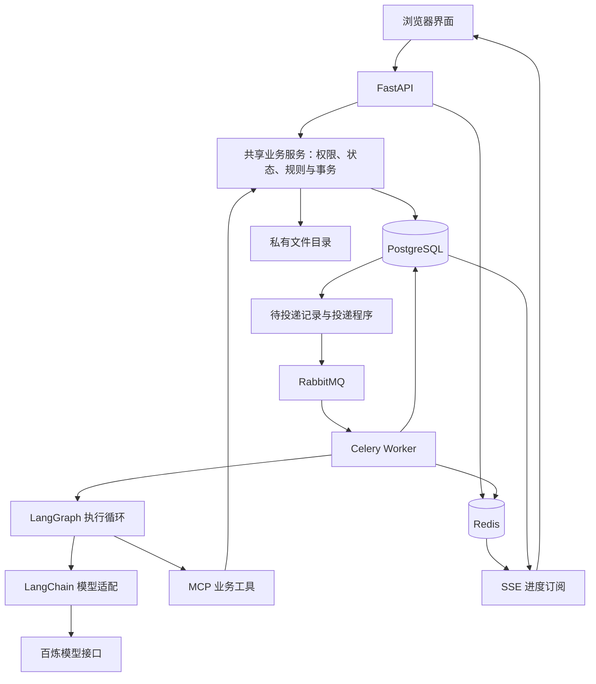

# Silencio Set 技术分析

本文结合当前实现，说明技术方案如何支撑学生剧组的前期筹备需求。课程设计文档中的早期模型及远期能力，以实际实现说明为准。

## 1. 总体架构与选型理由

系统采用前后端分离的模块化单体架构。账号、剧组、任务、创作资料、档期、资源、排期和通告分别组织代码，共用业务服务和 PostgreSQL。API、消息投递程序和 Worker 分进程运行，但没有拆分成微服务。

这种方式适合个人开发和当前规模：业务规则可以集中维护，跨模块操作能够使用数据库事务，也避免了服务发现、跨服务事务和多套部署带来的维护成本。将耗时任务移到 Worker，已经能够满足接口与后台执行分离的需要。

| 层次 | 当前技术 | 作用及选择依据 |
|---|---|---|
| 前端 | React、TypeScript、Vite、Ant Design | 组织任务、资源、排期等交互页面；类型约束辅助维护接口与表单 |
| 前端数据管理 | TanStack Query | 管理服务端数据的读取、缓存及更新；身份变化时清理私有数据，避免跨账号复用 |
| API | FastAPI、Pydantic | 提供 HTTP 接口、身份校验、输入验证和统一错误响应 |
| 业务与持久化 | SQLAlchemy、Alembic、PostgreSQL | 保存结构化关系、事务、版本及操作记录，管理数据库迁移 |
| 临时状态 | Redis | 保存会话、验证码、限流状态，并为 Agent 进度提供唤醒信号 |
| 后台任务 | RabbitMQ、Celery | 将消息投递与耗时处理分离，支持通知及 Agent 后台执行 |
| 智能助手 | LangChain、LangGraph、MCP | 分别负责模型适配、执行流程与状态、业务工具接入 |
| 模型 | 百炼 `deepseek-v4.1-flash` 兼容接口 | 当前实际接入配置；早期 Qwen 选型不代表当前模型 |
| 文件 | 本地私有目录 | 保存剧本及勘景文件，由后端鉴权访问，符合当前不租服务器的范围 |

图中 Worker→LangGraph 表示 Diane 队列的执行路径；普通通知消费者不调用模型。

## 2. 业务建模：让资料能够相互关联

系统围绕“剧组—剧本版本—场戏—拍摄场次”建立关系，并把任务、演员、设备、场地和通告关联到具体对象。这样，排期检查可以使用人员和资源记录，通告可以引用正式计划，来源变化也可以定位到受影响资料。

剧组是主要数据边界。同一用户可以加入多个剧组，但访问对象时仍要检查所在剧组、成员身份、操作权限及对象范围。只在页面隐藏按钮不足以完成权限控制，HTTP 接口和 Agent 工具都需要经过后端业务服务。

## 3. 资源预约与多人修改的一致性

资源预约的难点是同时占用数量和并发写入。例如两盏灯，已有两笔预约分别占用不重叠的时段，新的申请不能把这两笔数量简单相加，而需要计算申请区间内的占用峰值。

当前实现将时间区间视为左闭右开，通过开始时间增加数量、结束时间释放数量，按时间排序计算峰值。同一时刻结束的预约可以释放给下一笔预约使用。计算本身的主要开销随所选预约数量排序增长，不能将其描述为与数据量无关的常数操作。

写入时，在数据库事务内按既定顺序锁定剧组及相关资源，再读取当前占用、验证容量并保存，避免两个请求都基于旧余量通过检查。

对于多人编辑，使用 `lock_version` 检查客户端读取后的数据是否已发生变化。版本不符时要求重新读取确认，避免静默覆盖。这个并发版本与“剧本第几版、计划第几版”的业务版本分别管理。

## 4. 排期、通告和来源变更

计划草稿与正式发布版本分开管理。发布前检查人员时间、资源容量、预约分配和成员档期等条件，并在发布事务内重新核验，避免仅依据早先的页面检查结果发布。

通告引用具体正式计划版本，并保存发布时的内容及接收人信息。剧本、演员绑定、档期或计划变化时，关联资料需要重新判断适用性，通知已读也不代表业务问题已经解决。

因此，系统同时保留业务版本、并发版本和来源关联。前者说明发布了什么，中者防止修改覆盖，后者说明结论依据什么。当前变更检查由用户显式触发，没有持续运行全剧组自动检查任务。

## 5. Diane：从工具调用到持久状态

Diane 使用受限制的单 Agent 循环：模型理解问题并选择工具，工具查询业务数据，再由模型整理回答；达到次数、时间或上下文预算时结束。没有引入多 Agent 协作。

LangChain 负责模型与工具适配，LangGraph 组织 `model → tools → model` 的流转并保存节点检查点。MCP 提供结构化的工具名称、参数和结果，工具继续调用既有业务服务，因此不会产生另一套权限和业务规则。

当前 MCP 采用进程内的 Streamable HTTP ASGI 传输，执行实际协议通信，但没有开放额外监听端口。用户和剧组由服务器绑定，模型只提供查询参数。后续若拆成独立服务，仍需补充服务认证和身份传递。

记忆分为四类：数据库中的完整问答、有限的近期问答上下文、用户明确保存的回答偏好，以及 LangGraph 的运行检查点。近期上下文最多选取六轮成功问答并限制字节数，旧工具结果不会直接作为本轮实时事实。

例如“刚才那场戏”可以借助历史理解，但“这台设备现在还有没有余量”必须重新查询。检查点记录已完成不等于已实现中断自动恢复，当前不会自动重放中断的模型运行。

现阶段直接查询结构化业务数据更适合任务、档期、资源等动态事实。未实现向量检索、Agentic RAG 或 GraphRAG；剧本语义检索可在出现明确需求后独立评估。

## 6. 后台执行与消息可靠性

聊天提交后，API 在同一数据库事务中保存问题、运行标识和待投递状态，先返回受理结果。投递程序再向 RabbitMQ 发送运行 UUID，Celery Worker 领取执行权后重新授权并运行 Agent。

这解决了“数据库已保存、消息却未发出”的协调问题：投递失败时，数据库记录仍可用于后续投递。消息允许重复到达，业务通过运行状态和执行凭据限制重复执行；客户端重复提交相同请求也返回原记录。不能将这种实现称为整个消息系统天然恰好执行一次。

运行阶段和最终结果保存在 PostgreSQL。Redis 仅发送版本唤醒信号，SSE 读取数据库中的最新快照推送给页面。窗口收起会关闭订阅，但不会取消 Worker；重新打开读取同一次运行，避免重新调用模型。

当前 SSE 展示阶段与最终答案，尚未逐 token 输出正文。后台查询与任务提案是两条不同流程，任务提案生成和确认目前仍同步处理。

## 7. 受控写入与安全边界

模型可以拟定任务标题和说明，但不能直接创建正式任务。负责人和截止时间由用户选择，服务器绑定。提案保存后，用户审阅并确认指定版本；系统重新检查权限、成员状态和有效期，再复用任务服务创建最多五项任务。

整批任务、审计、事件和提案完成状态在同一事务提交，任意一项失败则全部回滚。重复确认使用稳定幂等标识，返回已有结果，避免产生重复任务。

安全控制还包括：

- 登录会话 Cookie、写请求的 Origin／CSRF 检查，以及验证码和请求频率限制。
- SQLAlchemy 参数绑定与输入校验，避免将用户输入拼接成 SQL。
- 剧组及对象范围授权，私有文件通过后端读取，模型密钥仅保存在后端配置。
- 限定工具目录，不提供任意 SQL、任意文件路径或身份切换能力；模型输出不能绕过权限和人工确认。

这些边界能够限制提示注入可能造成的越权后果，但不保证模型完全不受恶意文本影响。模型回答是否准确、是否遗漏信息，仍需单独评估。

## 8. 性能、成本与当前限制

Redis 当前主要承担临时状态，并没有把资源余量、发布状态等核心业务全面缓存。是否引入热点缓存，需要依据实际查询瓶颈决定；不能因为使用 Redis，就宣称已经解决缓存穿透、击穿和雪崩。

队列将耗时推理移出 HTTP 请求连接，改善接口等待方式，但不会让单次模型推理本身更快，也不能单独证明高 QPS。Agent 已设置模型调用次数、工具调用次数、上下文大小、输出、工作时限和并发预算，记录运行耗时及模型返回的 token 用量；未知用量保留为未知，估算与实际值分开。

当前完成了针对性的模块、数据库、浏览器与队列联调。后台链路先通过真实队列和独立 Worker、配合模拟模型验证；修复模型客户端生命周期后，又在虚构演示剧组连续完成三条真实模型后台请求，覆盖成员查询、一次身份切换提示及拍摄查询，详见[修复记录](diane-client-lifecycle-fix.md)。这仍不等于全面质量、安全或性能验收。

尚需真实剧组试用、并发负载与稳定性验证，以及公网环境的 HTTPS、邮件、备份和进程管理配置。当前适合表述为“核心业务与 Agent 链路已接通，可本机演示”，不宣称企业级高并发已经验收。

## 9. 展示时的技术总结

项目的技术重点，是将剧组筹备中的关联关系、版本和资源约束落实为可执行的业务规则，再让 Agent 通过同一套权限与服务使用这些能力。数据库负责正确保存状态，队列负责分离耗时工作，模型负责理解和整理，最终业务修改由规则和用户确认共同约束。

实现细节可对照：[记忆与 MCP](diane-memory-and-mcp.md)、[后台与 SSE](diane-background-and-sse.md)、[任务提案](diane-task-proposals.md)。
